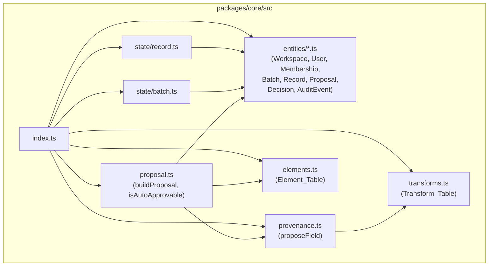
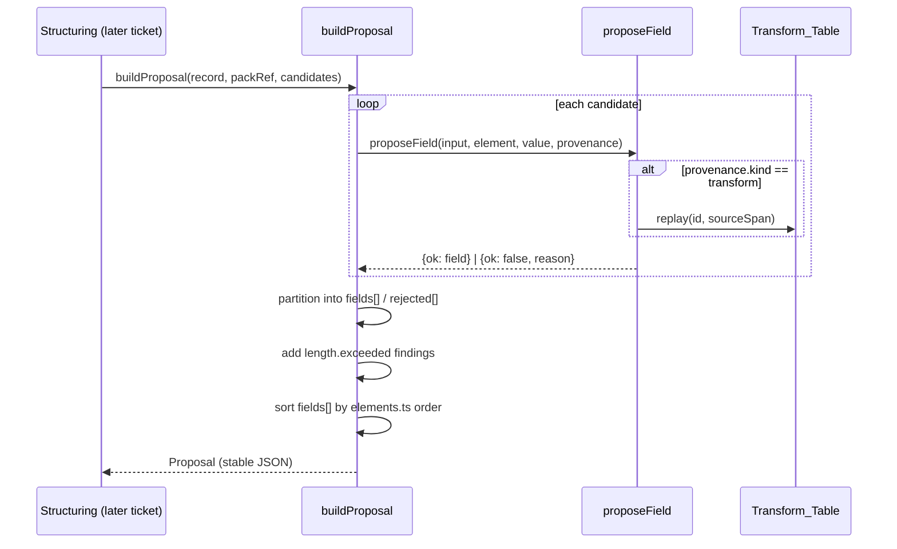

# Design Document

## Overview

`packages/core` (Core_Package) is the pure domain module of 4x35. This ticket (M1-01) builds the
part of it that enforces the never-invent promise (ADR 0008) and the Batch/Record lifecycle
(`docs/architecture.md` §2) as code, not convention:

- Entity types and zod schemas for the entities named in `docs/architecture.md` §2.
- `provenance.ts`: `proposeField`, the only function that decides whether a candidate value may
  become a field, enforcing the six Provenance_Kind shapes.
- `transforms.ts`: the closed, versioned Transform_Table, with the first three entries (`nfc`,
  `whitespace.collapse`, `case.upper`).
- `elements.ts`: the Element_Table (PostalAddress24 maximum lengths).
- `proposal.ts`: `buildProposal`, the only way to construct a Proposal.
- `state/batch.ts`, `state/record.ts`: typed transition functions for the two state machines
  drawn in `docs/architecture.md` §2.
- The Import_Guard_Test, extended to the full forbidden-import list.

Everything here is pure: no network, filesystem, database, or framework import (ADR 0001, R9).
Rule vocabulary, packs, the per-message-version element map, country detection, parsers, dataset
lookups, postcode/transliteration transforms and confidence scoring are out of scope (later
tickets: M2-06, M2-10 through M2-15).

## Architecture



Call shape for a later module (e.g. Structuring, M2-xx) building a Proposal:



No module outside `packages/core` is touched by this ticket. `packages/core` itself has zero
runtime dependencies on `node:*`, `pg`, `drizzle-orm`, `hono`, or any SDK (R9); its only
dependencies are `zod` and, in test code, `fast-check`.

## Components and Interfaces

### Module layout

```
packages/core/
  src/
    entities/
      workspace.ts      # Workspace, User, Membership (role: 'owner' | 'reviewer'), Invite,
                         # Session, ApiToken
      batch.ts           # Batch
      record.ts           # Record (originalLines: readonly)
      proposal.ts         # Proposal, Field, Finding, Decision-adjacent shapes used by Proposal
      decision.ts         # Decision
      audit-event.ts       # AuditEvent
    elements.ts          # Element_Table: PostalAddress24 element -> max length / occurrence rule
    provenance.ts         # Provenance union, Candidate, proposeField
    transforms.ts          # Transform_Table, TransformEntry, replay()
    proposal.ts            # buildProposal, isAutoApprovable  (Proposal_Builder, Auto_Approval_Policy)
    state/
      batch.ts             # Batch_State_Machine: transitionBatch(current, event) -> next | throws
      record.ts            # Record_State_Machine: transitionRecord(current, event) -> next | throws
    index.ts               # re-exports the public surface
  test/
    import-guard.test.ts         # extended M0-05 Import_Guard_Test
    provenance.property.test.ts   # P-never-invent, P-span-exact, P-transform-replays
    proposal.property.test.ts     # P-no-truncation, P-not-auto-approvable, P-proposal-deterministic
    state.test.ts                 # P-batch-transitions, P-record-transitions
```

`packages/core/src/entities/proposal.ts` (entity shapes: `Proposal`, `Field`, `Finding`) is
distinct from `packages/core/src/proposal.ts` (the `buildProposal` constructor and
`isAutoApprovable`), matching the ticket's deliverable list, which names both
`entities/*.ts` and a top-level `proposal.ts`.

### Type shapes

#### Provenance union (`provenance.ts`)

```typescript
export type Span = { readonly start: number; readonly end: number };

export type Provenance =
  | { readonly kind: "span"; readonly span: Span }
  | { readonly kind: "transform"; readonly transformId: string; readonly sourceSpan: Span }
  | {
      readonly kind: "dataset";
      readonly datasetId: string;
      readonly recordKey: string;
      readonly unique: true;
      readonly corroboratingSpan: Span;
    }
  | {
      readonly kind: "inferred";
      readonly ruleId: string;
      readonly sourceSpan?: Span;
      readonly sourceField?: string;
      // exactly one of sourceSpan / sourceField must be present; proposeField rejects both-absent
      // and both-present as an invalid reference, per R1.4 ("either ... or").
    }
  | { readonly kind: "human"; readonly sessionActorId: string }
  | { readonly kind: "external"; readonly apiTokenId: string };

export type Candidate = {
  readonly element: ElementId; // from elements.ts
  readonly value: string;
  readonly provenance: Provenance;
};

export type RejectionReason =
  | "no_provenance"
  | "unknown_provenance_kind"
  | "span_out_of_range"
  | "span_value_mismatch"
  | "unknown_transform"
  | "transform_replay_mismatch"
  | "dataset_reference_invalid"
  | "inferred_reference_invalid"
  | "human_reference_invalid"
  | "external_reference_invalid";

export type ProposeResult =
  | { readonly ok: true; readonly field: Field }
  | { readonly ok: false; readonly reason: RejectionReason };
```

`Field` (defined in `entities/proposal.ts`) is `{ element: ElementId; value: string; provenance:
Provenance; confidence?: number }`. `proposeField` never fills `confidence`; that is M2-15.

#### Transform table entries (`transforms.ts`)

```typescript
export type TransformEntry = {
  readonly id: string;       // unique, non-empty, stable across versions
  readonly version: number;  // bumped only when the function's output changes for some input
  readonly apply: (input: string) => string; // pure, no I/O
};
```

Resolved semantics for the three entries this ticket ships (the ticket text names them but does
not pin exact behaviour; the open questions below are resolved here so `P-transform-replays` has
one unambiguous implementation to replay):

- **`nfc`**: Unicode NFC normalisation only (`String.prototype.normalize("NFC")`). It does **not**
  trim or collapse whitespace — those are `whitespace.collapse`'s job. Composing the two transforms
  in sequence is a candidate's choice (the Candidate names one transform id per field in this
  ticket; chained transforms are out of scope until a later ticket needs them).
- **`whitespace.collapse`**: replaces every run of Unicode whitespace (regex `\s`, which covers
  space, tab, and non-breaking space U+00A0 once the input is NFC — NFC does not decompose NBSP)
  with a single ASCII space (`U+0020`), and additionally strips leading and trailing whitespace.
  Resolved open question: **trimming is included** in `whitespace.collapse`, because the ticket's
  own address-line domain (steering: whitespace runs of 3+, tabs, NBSP) implies leading/trailing
  runs are the common failure case for free-text MT lines, and a separate `whitespace.trim` entry
  would be an unrequested addition to the closed table. `whitespace.collapse` is idempotent:
  `apply(apply(s)) === apply(s)` for all `s`.
  - Only the whitespace runs defined by `\s` (`/\s+/gu`) are collapsed. `\s` covers NBSP under the
    `u` flag.
- **`case.upper`**: resolved open question (**locale-independent upper-casing**): uses
  `String.prototype.toLocaleUpperCase("en-US")` called with the fixed locale `"en-US"` pinned as a
  literal argument — never the no-argument `toUpperCase()` and never the ambient-locale
  `toLocaleUpperCase()` — so that the transform is deterministic across any Node process locale
  and across machines (ADR 0008 requires transforms to be replayable; an ambient-locale-dependent
  function is not replayable). This intentionally does not apply Turkish dotless-ı or German
  ß-to-SS special casing, since those are locale-specific and the pack charset for any given
  country is decided in a later ticket (M2-10 Latin-ASCII folding); `case.upper` here is a single,
  fixed, replayable function, not a per-locale family.

`replay(transformId, sourceSpan, input)` looks up the entry by id in the Transform_Table, takes
`nfc(input).slice(sourceSpan.start, sourceSpan.end)` as the transform's input, and calls `apply`
on it. `proposeField` accepts a `transform` candidate only if `replay(...)` equals the candidate's
value exactly.

#### Element table (`elements.ts`)

```typescript
export type ElementId =
  | "StrtNm" | "BldgNb" | "BldgNm" | "Flr" | "PstBx" | "Room" | "PstCd"
  | "TwnNm" | "TwnLctnNm" | "DstrctNm" | "CtrySubDvsn" | "Ctry" | "AdrLine";

export type ElementSpec = { readonly id: ElementId; readonly maxLength: number; readonly maxOccurrences: number };
```

Values per `.kiro/steering/iso20022-addresses.md` and R3.1: StrtNm 70, BldgNb 16, BldgNm 35, Flr
70, PstBx 16, Room 70, PstCd 16, TwnNm 35, TwnLctnNm 35, DstrctNm 35, CtrySubDvsn 35, Ctry 2 (max
occurrences 1 for all of these), AdrLine 70 (max occurrences 7). The array order in `elements.ts`
is the fixed element order `buildProposal` sorts `fields[]` by (R4.6): StrtNm, BldgNb, BldgNm,
Flr, PstBx, Room, PstCd, TwnNm, TwnLctnNm, DstrctNm, CtrySubDvsn, Ctry, AdrLine.

#### Proposal, Candidate, Finding (`entities/proposal.ts`)

```typescript
export type Finding = {
  readonly ruleId: string;
  readonly severity: "reject" | "strip" | "warn";
  readonly message: string;
};

export type RejectedCandidate = { readonly candidate: Candidate; readonly reason: RejectionReason };

export type Proposal = {
  readonly recordId: string;
  readonly packRef: string; // packId@version
  readonly fields: readonly Field[];      // sorted by elements.ts order
  readonly rejected: readonly RejectedCandidate[];
  readonly findings: readonly Finding[];
};
```

`buildProposal(record, packRef, candidates)` is the sole exported constructor; there is no other
exported function or class that can produce a `Proposal` value (R4.1).

### Entities (`entities/*.ts`)

Zod schemas mirror `docs/architecture.md` §2 exactly, scoped to this ticket (no persistence
fields such as DB-generated ids beyond what the domain needs to reference by id):

- **Workspace**: `{ id, name }`.
- **User**: `{ id, email }`.
- **Membership**: `{ workspaceId, userId, role: z.enum(["owner", "reviewer"]) }` (R8.2).
- **Invite**, **Session**, **ApiToken**: minimal shapes sufficient for `human`/`external`
  provenance references (`sessionActorId`, `apiTokenId`) to type-check; full lifecycle fields are
  M1-03 (Identity).
- **Batch**: `{ id, workspaceId, kind: z.enum(["master_list", "payment_file"]), format,
  originalBytesRef, sha256, encoding, delimiter, eol, columnMap, packRef, targetForm:
  z.enum(["structured", "hybrid"]), state: BatchState }`.
- **Record**: `{ id, batchId, location, partyRole, name, originalLines: readonly string[],
  countryHint, version: number, state: RecordState }`. `originalLines` is typed
  `readonly string[]` (TypeScript `readonly` array, R8.3); no setter exists.
- **Decision**: `{ recordId, proposalVersion, action: z.enum(["approve", "edit", "unknown",
  "reopen"]), fieldsAfterEdit, actorId, actorKind: z.enum(["session", "token"]), at }`.
- **AuditEvent**: `{ id, actorId, action, subjectId, at, dataHash }`.

### State machines (`state/batch.ts`, `state/record.ts`)

Transition tables, copied exactly from `docs/architecture.md` §2:

**Batch** — states: `uploaded, parsing, parsed, structuring, ready_for_review, reviewed, exported,
failed, purged`.

| From | Event / to |
|---|---|
| `uploaded` | → `parsing` |
| `parsing` | → `parsed` |
| `parsed` | → `structuring` |
| `structuring` | → `ready_for_review` |
| `ready_for_review` | ⇄ `reviewed` (both `ready_for_review → reviewed` and `reviewed → ready_for_review` are permitted) |
| `reviewed` | → `exported` |
| `exported` | → `exported` (new Export row; this is the one permitted self-move) |
| any of `uploaded, parsing, parsed, structuring, ready_for_review, reviewed` | → `failed(reason)` |
| any state | → `purged` (tombstone), permitted only after 30 days, unless locked or a judge sandbox — this ticket's `transitionBatch` takes the 30-day/locked/sandbox gate as a precomputed boolean input (`purgeEligible: boolean`) rather than reading time or lock state itself, since `packages/core` does no I/O (ADR 0001); the caller (a later ticket) computes `purgeEligible` and passes it in. `transitionBatch` throws `IllegalTransition` if `→ purged` is requested with `purgeEligible: false`. |

All other ordered pairs (including unlisted self-moves, e.g. `uploaded → uploaded`,
`parsed → parsed`, and any backward move other than `reviewed → ready_for_review`) throw
`IllegalTransition`.

**Record** — states: `pending, proposed, auto_approvable, needs_review, already_valid, approved,
edited, unknown`.

| From | Event / to |
|---|---|
| `pending` | → `proposed` |
| `proposed` | → `auto_approvable` \| `needs_review` \| `already_valid` |
| `auto_approvable` | → `approved` \| `edited` \| `unknown` |
| `needs_review` | → `approved` \| `edited` \| `unknown` |
| `approved` | → `needs_review` (reopen) |
| `edited` | → `needs_review` (reopen) |
| `unknown` | → `needs_review` (reopen) |

`already_valid` has no documented outgoing move in architecture §2; `transitionRecord` therefore
throws `IllegalTransition` for every move out of `already_valid`, including to `needs_review`.
All other ordered pairs not listed above (including every self-move, since none is drawn for
Record) throw `IllegalTransition`.

```typescript
export class IllegalTransition extends Error {
  constructor(readonly from: string, readonly to: string, readonly machine: "batch" | "record") {
    super(`Illegal ${machine} transition: ${from} -> ${to}`);
  }
}

export function transitionBatch(current: BatchState, to: BatchState, opts?: { purgeEligible?: boolean }): BatchState;
export function transitionRecord(current: RecordState, to: RecordState): RecordState;
```

### Auto-approval policy (`proposal.ts`)

```typescript
export function isAutoApprovable(field: Field, validatorsAgree: boolean): boolean {
  if (field.provenance.kind === "span" || field.provenance.kind === "transform") {
    return validatorsAgree;
  }
  return false; // dataset, inferred, external, human
}
```

### Import Guard Test

Location: `packages/core/test/import-guard.test.ts` (extends the M0-05 guard). It walks every
file under `packages/core/src/`, parses static `import`/`export ... from`, dynamic `import()`,
and `require()` call sites, and fails listing file + specifier for any specifier matching
`node:*`, `pg`, `drizzle-orm`, `hono`, or a fixed list of known SDK package names (`@anthropic-ai/sdk`,
`@modelcontextprotocol/sdk`). This is an example/fixture-style test (R9 prework: no meaningful
generated-input property — the input is the fixed, literal source tree), covering all four import
syntaxes with one fixture file per syntax plus the real scan of `src/`.

## Data Models

No database tables are introduced by this ticket (persistence is M1-02). The in-memory shapes are
the zod schemas in `entities/*.ts` above, which M1-02 will map 1:1 to tables. `Proposal` has no
identity of its own beyond `recordId` + `packRef`; persistence versioning is also M1-02.

## Correctness Properties

*A property is a characteristic or behavior that should hold true across all valid executions of
a system — essentially, a formal statement about what the system should do. Properties serve as
the bridge between human-readable specifications and machine-verifiable correctness guarantees.*

### Property 1: Never invents (P-never-invent) (M1-01)

FOR ALL inputs and candidate sets, THE Provenance_Checker SHALL satisfy: every field it accepts is
either a `span` of the NFC-normalised input, a `transform` whose replay on its source span equals
the value, or a `dataset`/`inferred`/`human`/`external` value carrying its required reference
fields exactly as specified in R1.1–R1.7; no candidate lacking one of these shapes is ever
accepted.

**Validates: Requirements 1.7, 1.8**

### Property 2: Span exact (P-span-exact) (M1-01)

FOR ALL NFC-normalisable inputs and all accepted `span` fields, THE Provenance_Checker SHALL
satisfy that the field's value equals the NFC-normalised input's substring at the claimed
`[start, end)` offsets, exactly, with no normalisation, trimming, or case change applied.

**Validates: Requirements 1.1, 1.9**

### Property 3: Transform replays (P-transform-replays) (M1-01)

FOR ALL NFC-normalisable inputs, all Transform_Table entries, and all source spans, THE
Provenance_Checker SHALL satisfy that an accepted `transform` field's value equals
`replay(transformId, sourceSpan, input)`, and SHALL reject any candidate whose claimed value
differs from that replay.

**Validates: Requirements 1.2, 1.10, 2.3**

### Property 4: No truncation (P-no-truncation) (M1-01)

FOR ALL records, pack references, and candidate sets, THE Proposal_Builder SHALL satisfy that no
value in `fields[]` is a strict prefix of its originating candidate's value, and that every
candidate whose value exceeds its element's maximum length produces exactly one `length.exceeded`
Finding with severity `reject` when (and only when) the value is otherwise accepted, with the full
value retained — never shortened and never silently moved to `rejected[]` for length alone.

**Validates: Requirements 3.2, 3.3, 3.4, 3.5, 4.5**

### Property 5: Not auto-approvable (P-not-auto-approvable) (M1-01)

FOR ALL fields of Provenance_Kind `dataset`, `inferred`, `external`, or `human`, and for any value
of `validatorsAgree`, THE Auto_Approval_Policy SHALL satisfy `isAutoApprovable(field,
validatorsAgree) === false`.

**Validates: Requirements 5.3, 5.4**

### Property 6: Proposal deterministic (P-proposal-deterministic) (M1-01)

FOR ALL records, pack references, and candidate sets, THE Proposal_Builder SHALL satisfy that
calling `buildProposal` twice with the candidates presented in any two orders (including a
reversed or shuffled order) SHALL produce byte-identical serialised JSON, with `fields[]` sorted
by the fixed element order of `elements.ts`.

**Validates: Requirements 4.6, 4.7**

### Property 7: Batch transitions (P-batch-transitions) (M1-01)

FOR ALL ordered pairs of Batch states (including every self-move), THE Batch_State_Machine SHALL
satisfy that `transitionBatch` returns the new state exactly for the pairs drawn in
`docs/architecture.md` §2 (under the stated `purgeEligible` gate for `→ purged`) and throws
`IllegalTransition` for every other pair.

**Validates: Requirements 6.1, 6.2, 6.3**

### Property 8: Record transitions (P-record-transitions) (M1-01)

FOR ALL ordered pairs of Record states (including every self-move), THE Record_State_Machine SHALL
satisfy that `transitionRecord` returns the new state exactly for the pairs drawn in
`docs/architecture.md` §2 and throws `IllegalTransition` for every other pair.

**Validates: Requirements 7.1, 7.2, 7.3**

### Reflection on property coverage

The prework identified several requirement clauses (R1.3–R1.6, R3.2–R3.4, R4.2–R4.6, R5.1–R5.3,
R6.1–R6.2, R7.1–R7.2) whose universal content is fully subsumed by one of the eight properties
above (matching the ticket's eight named properties exactly: `P-never-invent`, `P-span-exact`,
`P-transform-replays`, `P-no-truncation`, `P-not-auto-approvable`, `P-proposal-deterministic`,
`P-batch-transitions`, `P-record-transitions`). No ninth property is introduced. Per-kind
reference-shape rejection reasons (R1.3–R1.6), the fixed Transform_Table membership (R2.2), the
fixed Element_Table values (R3.1), the `isAutoApprovable` true-case (R5.1–R5.2, a 2×2 fixed
matrix), entity schema shapes (R8), and the Import_Guard_Test (R9) are covered by unit/example
tests instead, as recorded in the Testing Strategy below.

## Error Handling

- **Rejected candidates never throw.** `proposeField` always returns `{ok: false, reason}` for
  any invalid or missing provenance (R1.7); it never throws for a Candidate-shaped input. The
  caller decides whether to surface the reason to a user.
- **`IllegalTransition` is the only thrown error** in this ticket's surface, thrown exactly for
  disallowed Batch/Record moves (R6.2, R7.2), and carries `from`, `to`, and `machine` for
  diagnostics. No other function in `packages/core`'s M1-01 surface throws for a value that merely
  fails validation — invalid candidates are reported through `ProposeResult` / `rejected[]`, not
  exceptions, so Structuring (later tickets) can process a whole batch without a single bad
  candidate aborting it.
- **Unknown transform ids and malformed spans** are rejection reasons
  (`unknown_transform`, `span_out_of_range`, `span_value_mismatch`, `transform_replay_mismatch`),
  not thrown errors (R1.7, R2.3).
- **Over-length values are findings, never errors and never truncation.** `length.exceeded` is
  added to `findings[]` with severity `reject`; the value is still carried in full in `fields[]`
  if `proposeField` accepted it (R3.3, R4.5). Nothing in this ticket strips or shortens a string.
- **Zod parse failures** on entity construction throw zod's own `ZodError`; this ticket does not
  wrap or swallow those, since entity validation is a trust-boundary check (engineering standards:
  validate input at every trust boundary) and the caller is expected to handle `ZodError` the same
  way it handles any other schema violation.

## Testing Strategy

### Unit and example tests

- One rejection-reason unit test per `RejectionReason` value for each Provenance_Kind's required
  reference fields (R1.3–R1.6, R1.7): missing dataset id, missing record key, `unique !== true`,
  missing corroborating span, missing rule id for `inferred` with neither span nor field present,
  both span and field present for `inferred`, missing session actor id, missing API token id,
  unknown transform id, out-of-range span, span length mismatch.
- Transform_Table membership: `nfc`, `whitespace.collapse`, `case.upper` are present with unique,
  non-empty ids and a `version` (R2.1, R2.2).
- `whitespace.collapse` idempotence example: a string with mixed tabs/NBSP/multi-space runs
  collapses to the same result on a second application.
- `case.upper` locale-pin example: verifies the fixed `"en-US"` argument is used (e.g. confirms the
  function does not special-case Turkish dotless-ı, demonstrating it is not reading the ambient
  locale).
- `isAutoApprovable` true-case matrix (R5.1, R5.2): `span`/`transform` crossed with
  `validatorsAgree: true | false` (4 fixed cases).
- Entity schema examples: one valid instance and one invalid instance per entity in
  `entities/*.ts`, including the Membership role enum (R8.2) and a readonly-array type-level check
  for `Record.originalLines` (R8.3, enforced by `tsc`, not a runtime test).
- Import_Guard_Test fixtures: one fixture file per forbidden-import syntax (static `import`,
  `export ... from`, dynamic `import()`, `require()`), plus the real scan over `packages/core/src`
  (R9.1–R9.3).

### Property tests

Library: **fast-check** (already pinned at 4.10.2 in the tech stack), run under **vitest**.
Each of the eight correctness properties above maps to exactly one fast-check test. Every test
name contains the ticket's property id (`P-never-invent`, etc.) as required by the validation
gate's `grep`. Each test is tagged with a comment:
**Feature: domain-core, Property N: <property text>**.

`numRuns` is read from `process.env.FC_NUM_RUNS`, parsed as an integer, defaulting to `1000` when
unset, and passed as `{ numRuns: Number(process.env.FC_NUM_RUNS ?? 1000) }` to every
`fc.assert(...)` call — satisfying the ticket's "≥ 1,000 runs each" gate while letting CI override
it.

| Property | Test file | Test name contains |
|---|---|---|
| P1 P-never-invent | `provenance.property.test.ts` | `P-never-invent` |
| P2 P-span-exact | `provenance.property.test.ts` | `P-span-exact` |
| P3 P-transform-replays | `provenance.property.test.ts` | `P-transform-replays` |
| P4 P-no-truncation | `proposal.property.test.ts` | `P-no-truncation` |
| P5 P-not-auto-approvable | `proposal.property.test.ts` | `P-not-auto-approvable` |
| P6 P-proposal-deterministic | `proposal.property.test.ts` | `P-proposal-deterministic` |
| P7 P-batch-transitions | `state.test.ts` | `P-batch-transitions` |
| P8 P-record-transitions | `state.test.ts` | `P-record-transitions` |

#### Domain arbitraries

No property test uses a bare `fc.string()`. Shared arbitraries, defined once in a test-only
helper module (e.g. `packages/core/test/arbitraries.ts`, not part of the deliverable list but
needed to satisfy the steering's generator rules without duplicating them per file):

- **`addressLine`**: strings built from a mix of:
  - Unicode letters drawn from CJK (`\u4E00-\u9FFF`), Devanagari (`\u0900-\u097F`), Arabic
    (`\u0600-\u06FF`), Cyrillic (`\u0400-\u04FF`), and Latin with diacritics (`\u00C0-\u00FF`,
    `\u0100-\u017F`), composed via `fc.oneof` over per-script character generators.
  - Whitespace runs of length 1, 2, and **3 or more**, mixing space, tab (`\t`), and non-breaking
    space (`\u00A0`).
  - Both **NFC and NFD** normalised forms of the same generated text (`fc.string(...).map(s =>
    fc.oneof(constant(s.normalize("NFC")), constant(s.normalize("NFD"))))`), so span/transform
    replay logic is exercised against both forms of the same logical string.
  - Lengths concentrated around each field limit: **15, 16, 17** (BldgNb/PstBx/PstCd), **34, 35,
    36** (BldgNm/TwnNm/TwnLctnNm/DstrctNm/CtrySubDvsn), **69, 70, 71** (StrtNm/Flr/Room/AdrLine),
    via `fc.integer({min, max})`-sized strings built from the script/whitespace mix above, plus
    unconstrained lengths for general coverage.
- **`span`**: derived from a generated input string, not independent — `fc.tuple(input,
  fc.integer(), fc.integer())` filtered/mapped to valid `0 <= start < end <= input.length`, plus a
  deliberately out-of-range variant for the negative branch of P-never-invent / P-span-exact.
- **`transformId`**: `fc.constantFrom("nfc", "whitespace.collapse", "case.upper", "unknown.id")`
  (the last value exercises the `unknown_transform` rejection branch).
- **`provenance`**: `fc.oneof` over one generator per Provenance_Kind, each producing both a
  well-formed and a malformed (missing/invalid reference) instance, so P-never-invent's negative
  space is exercised as densely as its positive space.
- **`candidateSet`**: `fc.array(candidate, {minLength: 0, maxLength: 20})` for
  P-proposal-deterministic and P-no-truncation, permuted with `fc.shuffledSubarray` (full
  permutation, `size: "max"`) to generate the two orderings compared for determinism.
- **`batchStatePair` / `recordStatePair`**: `fc.tuple(fc.constantFrom(...allBatchStates),
  fc.constantFrom(...allBatchStates))` (and the Record equivalent) — a finite, enumerable domain,
  generated rather than hand-enumerated so the same exhaustive-table test doubles as a fast-check
  property per the ticket's request, while fast-check's `numRuns` still comfortably exceeds the
  finite pair count, achieving effectively exhaustive coverage.

#### Planted-bug record (required before the real implementation is accepted)

Per the steering rule that a property must be shown to catch a planted bug, the task that adds
each property records the deliberately wrong implementation it was run against, the counterexample
fast-check found, and the seed, before the correct implementation is restored. This design fixes
*which* bug to plant for each property; the task that implements the property records the actual
counterexample/seed output in the task's notes (not invented ahead of time here, since the exact
shrunk counterexample depends on the real fast-check run):

| Property | Planted bug |
|---|---|
| P-never-invent | `proposeField` accepts a `span` candidate without checking `end <= input.length` (off-by-one bounds check removed). |
| P-span-exact | `proposeField` compares the candidate value against `input.slice(start, end)` using the **raw** (non-NFC) input instead of `nfc(input)`. |
| P-transform-replays | `replay` is implemented to return the candidate's claimed value directly instead of recomputing `apply(nfc(input).slice(...))` (a no-op "trust the candidate" bug). |
| P-no-truncation | `buildProposal` truncates any value to its element's `maxLength` instead of keeping it full and adding a `length.exceeded` Finding. |
| P-not-auto-approvable | `isAutoApprovable` is implemented as `return validatorsAgree;` unconditionally (ignoring `kind`). |
| P-proposal-deterministic | `buildProposal` sorts `fields[]` by insertion order (candidate array order) instead of by the fixed `elements.ts` order. |
| P-batch-transitions | `transitionBatch` allows `uploaded -> uploaded` (an undrawn self-move) to succeed instead of throwing. |
| P-record-transitions | `transitionRecord` allows `already_valid -> needs_review` to succeed instead of throwing (treating it like the other three reopen sources). |

### Running the suite

`npm run test -w packages/core` runs both unit and property tests under vitest. The validation
gate additionally runs with `FC_NUM_RUNS=1000` and greps the verbose test log for each of the
eight property ids, matching this design's test-name convention exactly.
