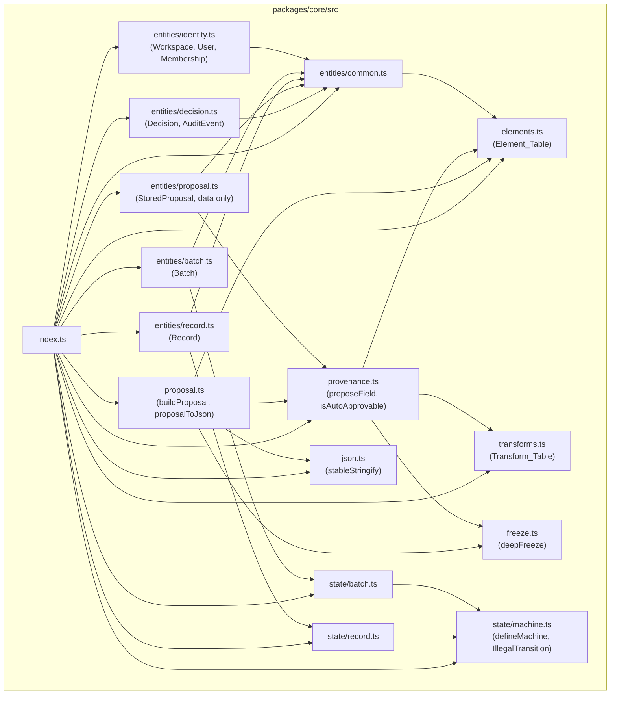
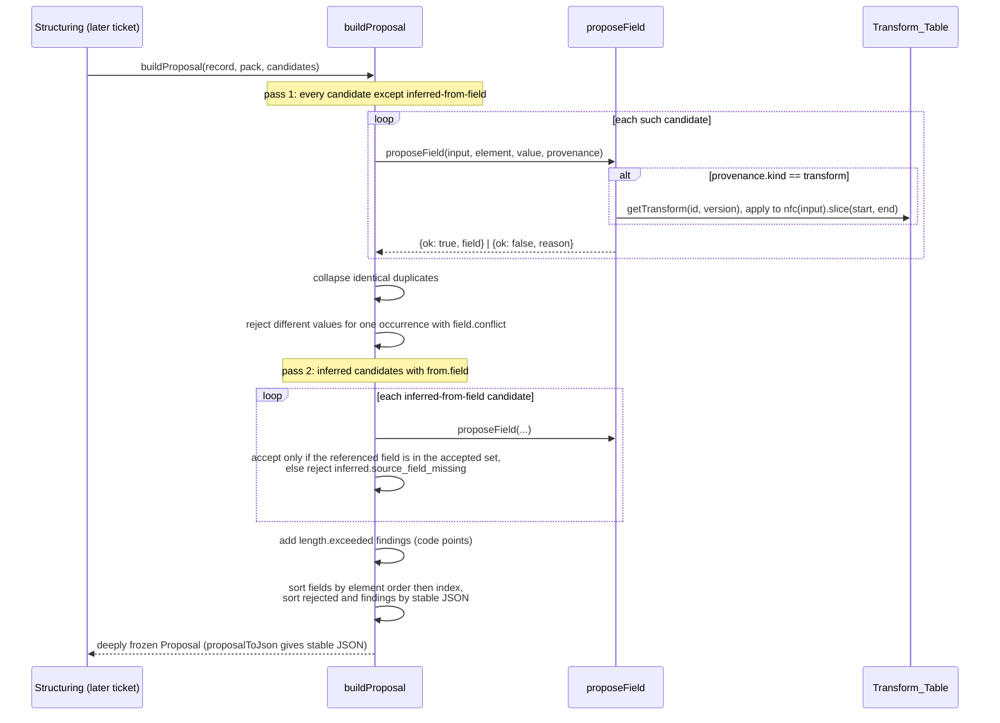

# Design Document

## Overview

`packages/core` (Core_Package) is the pure domain module of 4x35. This ticket (M1-01) builds the
part of it that enforces the never-invent promise (ADR 0008) and the Batch/Record lifecycle
(`docs/architecture.md` §2) as code, not convention:

- Entity types and zod schemas for the entities named in `docs/architecture.md` §2.
- `provenance.ts`: `proposeField`, the only function that decides whether a candidate value may
  become a field, enforcing the six Provenance_Kind shapes. It also holds `isAutoApprovable`.
- `transforms.ts`: the closed, versioned Transform_Table, with the first three entries (`nfc`,
  `whitespace.collapse`, `case.upper`).
- `elements.ts`: the Element_Table (PostalAddress24 maximum lengths).
- `proposal.ts`: `buildProposal`, the only way to construct a Proposal, and `proposalToJson`.
- `json.ts` and `freeze.ts`: `stableStringify` (stable JSON) and `deepFreeze`.
- `state/machine.ts`, `state/batch.ts`, `state/record.ts`: typed transition functions for the two
  state machines drawn in `docs/architecture.md` §2.
- The Purity_Test (`test/purity.test.ts`), which guards the forbidden-import list.

Everything here is pure: no network, filesystem, database, or framework import (ADR 0001, R9).
Rule vocabulary, packs, the per-message-version element map, country detection, parsers, dataset
lookups, postcode/transliteration transforms and confidence scoring are out of scope (later
tickets: M2-06, M2-10 through M2-15).

## Architecture



Call shape for a later module (e.g. Structuring, M2-xx) building a Proposal. `buildProposal` runs
two passes so that an `inferred` candidate derived from another field is only accepted when that
field survives conflict resolution:



No module outside `packages/core` is touched by this ticket. `packages/core` itself has zero
runtime dependencies on `node:*`, `pg`, `drizzle-orm`, `hono`, or any SDK (R9); its only runtime
dependency is `zod`, and in test code `fast-check` (and `typescript` for the Purity_Test).

## Components and Interfaces

### Module layout

```
packages/core/
  src/
    elements.ts          # ELEMENTS, Element, ELEMENT_MAX_LENGTH, ELEMENT_MAX_OCCURS, isElement,
                          # elementOrder, valueLength
    transforms.ts        # TRANSFORMS, TRANSFORM_IDS, getTransform, TransformDef, TransformId
    provenance.ts        # Provenance union, Field, ElementRef, Span, REJECTION_REASONS,
                          # proposeField, isAutoApprovable, nfc, recordInput, PROVENANCE_KINDS
    proposal.ts          # buildProposal, proposalToJson, Proposal, Candidate, Finding,
                          # FindingSeverity, LENGTH_EXCEEDED, PackRef, ProposalField,
                          # ProposalRecordInput, RejectedCandidate
    json.ts              # stableStringify, toJsonValue, JsonValue
    freeze.ts            # deepFreeze
    entities/
      common.ts          # IdSchema, Sha256HexSchema, NonEmptyString, ActorKindSchema,
                          # ElementSchema, CountryCodeSchema, PackRefSchema
      identity.ts        # Workspace, User, Membership (role: 'owner' | 'reviewer')
      batch.ts           # Batch
      record.ts          # Record (exported type DomainRecord), originalLines readonly
      proposal.ts        # StoredProposal zod schema (data only, not a Proposal)
      decision.ts        # Decision, AuditEvent
      index.ts           # re-exports the entities
    state/
      machine.ts         # defineMachine, Machine, MachineName, IllegalTransition
      batch.ts           # BATCH_STATES, BatchStatus, BATCH_ACTIVE_STATES, BATCH_EDGES,
                          # batchMachine, transitionBatch(from, to, {purgeEligible}),
                          # canTransitionBatch
      record.ts          # RECORD_STATES, RecordStatus, RECORD_EDGES, recordMachine,
                          # transitionRecord(from, to), canTransitionRecord
    index.ts             # re-exports the public surface (also WORKSPACE, JsonValue,
                          # stableStringify, nfc, recordInput, PROVENANCE_KINDS,
                          # REJECTION_REASONS)
  test/
    arbitraries.ts                # shared domain arbitraries, NUM_RUNS
    oracle.ts                     # reference oracle provesValue (independent restatement of ADR 0008)
    purity.test.ts                # Purity_Test (the import guard)
    entities.test.ts              # entity schema examples
    provenance.test.ts            # unit tests for proposeField, transforms, isAutoApprovable
    proposal.test.ts              # unit tests for buildProposal
    provenance.property.test.ts   # P1, P2, P3 and P5 (with their planted-bug tests)
    proposal.property.test.ts     # P4 and P6 (with their planted-bug tests)
    state.test.ts                 # P7 and P8, the exhaustive transition tables, planted-bug tests
    index.test.ts                 # public surface check
    smoke.prop.test.ts            # fast-check smoke test
```

`packages/core/src/entities/proposal.ts` (the `StoredProposal` zod schema, a data shape for parsing
stored rows) is distinct from `packages/core/src/proposal.ts` (the `buildProposal` constructor and
the `Proposal` type). A `StoredProposal` is data only; it is not a `Proposal`.

### Type shapes

#### Provenance union (`provenance.ts`)

Offsets are UTF-16 code-unit offsets into `nfc(recordInput(originalLines))`, where `recordInput`
joins the original lines with `"\n"`. A span is `[start, end)` and must not split a surrogate pair.

```typescript
export type Span = { readonly start: number; readonly end: number };

// One occurrence of an element: index is 0 except for AdrLine (0..6).
export type ElementRef = { readonly element: Element; readonly index: number };

export type Provenance =
  | { readonly kind: "span"; readonly span: Span }
  | {
      readonly kind: "transform";
      readonly transform: { readonly id: string; readonly version: number };
      readonly source: Span;
    }
  | {
      readonly kind: "dataset";
      readonly datasetId: string;
      readonly recordKey: string;
      readonly unique: true;
      readonly source: Span; // the input span that corroborates the match
    }
  | {
      readonly kind: "inferred";
      readonly ruleId: string;
      readonly from: { readonly span: Span } | { readonly field: ElementRef };
      // exactly one of span / field, as R1.4 ("either ... or")
    }
  | { readonly kind: "human"; readonly actorId: string }   // a session actor (user id)
  | { readonly kind: "external"; readonly tokenId: string }; // the API token it came through

export type Field = {
  readonly element: Element;
  readonly index: number;
  readonly value: string;
  readonly provenance: Provenance;
};

export const REJECTION_REASONS = [
  "candidate.invalid",
  "element.unknown",
  "element.index_out_of_range",
  "value.not_string",
  "value.empty",
  "provenance.missing",
  "provenance.kind_unknown",
  "span.invalid",
  "span.out_of_bounds",
  "span.splits_code_point",
  "span.mismatch",
  "transform.unknown",
  "transform.mismatch",
  "dataset.reference_missing",
  "dataset.not_unique",
  "inferred.rule_missing",
  "inferred.source_missing",
  "inferred.source_field_missing",
  "human.actor_missing",
  "external.token_missing",
  "field.conflict",
] as const;
export type RejectionReason = (typeof REJECTION_REASONS)[number];

export type ProposeFieldResult =
  | { readonly ok: true; readonly field: Field }
  | { readonly ok: false; readonly reason: RejectionReason };

export function proposeField(
  input: string,
  element: Element | ElementRef,
  value: string,
  provenance: Provenance,
): ProposeFieldResult;
```

`proposeField` runs `nfc(input)` itself, never throws, and returns every rejection reason except
`candidate.invalid`, `inferred.source_field_missing` and `field.conflict`, which only
`buildProposal` produces. `Field` carries no confidence: `ProposalField` adds `confidence:
number | null` (null until M2-15).

#### Transform table entries (`transforms.ts`)

```typescript
export interface TransformDef {
  readonly id: string;        // unique, non-empty
  readonly version: number;   // bumped only when the function's output changes for some input
  readonly description: string;
  readonly apply: (text: string) => string; // pure and total, no I/O
}
// TRANSFORMS: frozen table; TRANSFORM_IDS; getTransform(id, version) matches id AND version
```

Semantics of the three entries this ticket ships (all at version 1), fixed so
`P-transform-replays` has one unambiguous implementation to replay against:

- **`nfc`**: Unicode NFC normalisation only (`String.prototype.normalize("NFC")`). It does not trim
  or collapse whitespace; those are `whitespace.collapse`'s job. A candidate names one transform
  per field in this ticket; chained transforms are out of scope until a later ticket needs them.
- **`whitespace.collapse`**: replaces every run of Unicode whitespace (`/\s+/gu`, which covers
  space, tab and NBSP U+00A0) with a single ASCII space (U+0020), then trims both ends. It is
  idempotent: `apply(apply(s)) === apply(s)` for all `s`. Trimming is included because
  leading and trailing runs are the common failure case for free-text MT lines, and a separate
  `whitespace.trim` entry would be an unrequested addition to the closed table.
- **`case.upper`**: `String.prototype.toUpperCase()`. The ECMAScript specification defines
  `toUpperCase` as locale-independent (it uses the Unicode default case conversion, not the
  ambient locale), so the transform is deterministic across Node process locales and machines, as
  ADR 0008 requires of a replayable transform. No locale argument is passed. It does not apply
  Turkish dotless-ı or any other locale-specific casing; the pack charset for a country is decided
  in a later ticket (M2-10).

There is no separate `replay` export. The replay is inside `proposeField`: for a `transform`
provenance it looks up the entry with `getTransform(id, version)` (a wrong version is
`transform.unknown`), applies it to `nfc(input).slice(start, end)` of the `source` span, and
accepts the field only if the result equals the candidate's value exactly (otherwise
`transform.mismatch`).

#### Element table (`elements.ts`)

```typescript
export const ELEMENTS = [
  "StrtNm", "BldgNb", "BldgNm", "Flr", "PstBx", "Room", "PstCd",
  "TwnNm", "TwnLctnNm", "DstrctNm", "CtrySubDvsn", "Ctry", "AdrLine",
] as const;
export type Element = (typeof ELEMENTS)[number];
// ELEMENT_MAX_LENGTH, ELEMENT_MAX_OCCURS, isElement, elementOrder, valueLength
```

Values per `.kiro/steering/iso20022-addresses.md` and R3.1: StrtNm 70, BldgNb 16, BldgNm 35, Flr
70, PstBx 16, Room 70, PstCd 16, TwnNm 35, TwnLctnNm 35, DstrctNm 35, CtrySubDvsn 35, Ctry 2
(`ELEMENT_MAX_OCCURS` 1 for all of these), AdrLine 70 (`ELEMENT_MAX_OCCURS` 7, indexes 0 to 6).
Lengths are counted in Unicode code points: `valueLength` iterates code points, not UTF-16
units, because the XSD `maxLength` counts characters. The `ELEMENTS` array order is the fixed
element order `buildProposal` sorts `fields[]` by (R4.6), through `elementOrder`.

#### Proposal, Candidate, Finding (`proposal.ts`)

```typescript
export type PackRef = { readonly id: string; readonly version: string };
export type ProposalRecordInput = { readonly id: string; readonly originalLines: readonly string[] };

// element is Element | ElementRef
export type Candidate = {
  readonly element: Element | ElementRef;
  readonly value: string;
  readonly provenance: Provenance;
};

export type FindingSeverity = "reject" | "strip" | "warn";
export type Finding = {
  readonly ruleId: string;
  readonly severity: FindingSeverity;
  readonly target: ElementRef | null;
  readonly message: string;
};
export const LENGTH_EXCEEDED = "length.exceeded";

export type ProposalField = Field & { readonly confidence: number | null };
export type RejectedCandidate = { readonly candidate: JsonValue; readonly reason: RejectionReason };

declare const proposalBrand: unique symbol;
export type Proposal = {
  readonly [proposalBrand]: true; // an object literal does not type-check as a Proposal
  readonly recordId: string;
  readonly pack: PackRef;
  readonly fields: readonly ProposalField[];       // sorted by elementOrder, then index
  readonly rejected: readonly RejectedCandidate[]; // sorted by stable JSON
  readonly findings: readonly Finding[];           // sorted by stable JSON
};

export function buildProposal(
  record: ProposalRecordInput,
  pack: PackRef,
  candidates: readonly unknown[],
): Proposal;
export function proposalToJson(proposal: Proposal): string; // stableStringify
```

`buildProposal` is the sole exported constructor; there is no other exported function or class that
can produce a `Proposal` value (R4.1), and the type-level brand stops a literal from passing as
one. The returned Proposal is deeply frozen (`deepFreeze`).

Behaviour beyond the happy path:

- A malformed record, pack or a non-array `candidates` throws `TypeError` (a programmer error). A
  non-object candidate is not an error: it is rejected as `candidate.invalid`, and the rejected
  entry carries the candidate as a `JsonValue`.
- **Conflicts**: identical duplicates (same stable JSON) collapse to one field. Two different values
  or provenances for the same element occurrence are both rejected with `field.conflict`, in
  either order, so the field stays empty for review.
- **Second pass**: a candidate with `inferred` provenance and `from.field` is accepted only if the
  referenced field is in the accepted set after pass 1 (conflicts resolved). Otherwise it is
  rejected as `inferred.source_field_missing`. If it targets an occurrence that pass 1 emptied with
  `field.conflict`, it is rejected with `field.conflict` too: a later pass never picks a winner
  among conflicting values. Conflicts are then resolved again over the whole
  set, and any field inferred from an occurrence that this emptied is dropped the same way, until
  nothing changes (a chain never outlives its source).
- **Length**: a value longer than its element's limit in code points adds one `length.exceeded`
  Finding (severity `reject`, `target` the occurrence) and keeps the value in full. A value at the
  limit adds none.
- **Output order**: `fields[]` sorted by `elementOrder` then `index`; `rejected[]` and `findings[]`
  sorted by their stable JSON. `proposalToJson` is `stableStringify` (sorted keys, no whitespace,
  `undefined` dropped), and is what P6 compares.

### Entities (`entities/*.ts`)

Zod schemas mirror `docs/architecture.md` §2, scoped to this ticket. All are `.readonly()`. Ids are
UUIDs. There is no Invite, Session or ApiToken entity: the ticket does not name them, and the actor
reference in `human` and `external` provenance is a plain id string (`actorId`, `tokenId`).

- **Workspace** (`identity.ts`): `{ id, name, settings: { fourEyes, llmOptIn (default false),
  quotas (default {}) }, isSandbox, createdAt }`.
- **User**: `{ id, email, createdAt }`. Credentials belong to the identity module.
- **Membership**: `{ workspaceId, userId, role: z.enum(["owner", "reviewer"]) }` (R8.2).
- **Batch** (`batch.ts`): `{ id, workspaceId, kind: "master_list" | "payment_file", format: "csv" |
  "xlsx" | "pain001" | "mt101", original (Uint8Array), sha256, encoding, delimiter | null, eol:
  "lf" | "crlf" | "cr" | null, columnMap | null, pack: { id, version }, form: "structured" |
  "hybrid", status, failureReason | null, locked, createdBy, createdAt, purgeAfter }`.
- **Record** (`record.ts`, exported type `DomainRecord`): `{ id, batchId, location (cell, xml or mt
  variant), partyRole, name | null, originalLines: z.array(z.string()).readonly(), countryHint |
  null, status, version }`. The field is `status`, not `state` (R8.3).
- **StoredProposal** (`proposal.ts`): `{ recordId, pack, fields[] (with confidence | null),
  rejected[], findings[] }`, the parse shape of a stored Proposal, data only.
- **Decision** (`decision.ts`): `{ id, recordId, proposalId, action: "approve" | "edit" | "unknown"
  | "reopen", fields | null, actorId, actorKind: "session" | "token", at }`.
- **AuditEvent**: `{ id, workspaceId, actorId, actorKind, action, subject, dataHash, at }`.

### State machines (`state/machine.ts`, `state/batch.ts`, `state/record.ts`)

`machine.ts` defines `defineMachine(name, states, edges)`, which returns a frozen `Machine` with
`canTransition` and `transition`, and `IllegalTransition(machine, from, to)` (argument order
machine, from, to). Both machines are built from an explicit edge list copied from
`docs/architecture.md` §2.

**Batch** states: `uploaded, parsing, parsed, structuring, ready_for_review, reviewed, exported,
failed, purged`. `BATCH_ACTIVE_STATES` are `uploaded, parsing, parsed, structuring,
ready_for_review, reviewed`. `BATCH_EDGES` has 22 edges:

| Group | Edges |
|---|---|
| Main flow (8) | `uploaded → parsing`, `parsing → parsed`, `parsed → structuring`, `structuring → ready_for_review`, `ready_for_review → reviewed`, `reviewed → ready_for_review`, `reviewed → exported`, `exported → exported` (new Export row, the one permitted self-move) |
| To failed (6) | each active state `→ failed` |
| To purged (8) | every state except `purged` `→ purged` |

The `→ purged` edges need `purgeEligible === true`. The 30-day, locked and judge-sandbox gate is
computed by the caller and passed in, since `packages/core` does no I/O (ADR 0001); with
`purgeEligible` false or absent, `transitionBatch` throws `IllegalTransition`. All other ordered
pairs, including undrawn self-moves such as `uploaded → uploaded`, throw.

**Record** states: `pending, proposed, auto_approvable, needs_review, already_valid, approved,
edited, unknown`.

| From | To |
|---|---|
| `pending` | `proposed` |
| `proposed` | `auto_approvable`, `needs_review`, `already_valid` |
| `auto_approvable` | `approved`, `edited`, `unknown` |
| `needs_review` | `approved`, `edited`, `unknown` |
| `approved`, `edited`, `unknown` | `needs_review` (reopen) |

`already_valid` has no outgoing edge, so every move out of it throws `IllegalTransition`, including
to `needs_review`. Every other ordered pair, including every self-move, throws.

```typescript
export class IllegalTransition extends Error {
  constructor(readonly machine: "batch" | "record", readonly from: string, readonly to: string);
}

export function transitionBatch(from: BatchStatus, to: BatchStatus, opts?: { purgeEligible?: boolean }): BatchStatus;
export function transitionRecord(from: RecordStatus, to: RecordStatus): RecordStatus;
// canTransitionBatch / canTransitionRecord return a boolean instead of throwing
```

### Auto-approval policy (`provenance.ts`)

```typescript
export function isAutoApprovable(field: Pick<Field, "provenance">, validatorsAgree: boolean): boolean {
  switch (field.provenance.kind) {
    case "span":
    case "transform":
      return validatorsAgree === true;
    default:
      return false; // dataset, inferred, external, human
  }
}
```

### Purity test

Location: `packages/core/test/purity.test.ts`. It is a TypeScript-AST based guard (it reads imports
with `ts.preProcessFile`) over every file under `packages/core/src/`. It has five tests:

1. It finds source files to check.
2. `src` imports no Node built-in (with or without the `node:` prefix) and no I/O package. The
   forbidden list covers databases and jobs (`pg`, `pg-boss`, `drizzle-*`, Redis), HTTP servers
   and clients (`hono`, `undici`, `axios`, ...), model, cloud and platform SDKs
   (`@anthropic-ai/*`, `@modelcontextprotocol/*`, `@aws-sdk/*`, ...), logging and file libraries,
   and the outer workspaces (`@4x35/db`, `@4x35/server`, ...).
3. The forbidden-import matcher recognises each form a forbidden import can take.
4. The scan finds static, re-export, dynamic `import()` and `require()` imports.
5. `package.json` declares no runtime dependency but `zod`.

It is example-style, since the input is the fixed source tree and has no meaningful generated
domain (R9 prework).

## Data Models

No database tables are introduced by this ticket (persistence is M1-02). The in-memory shapes are
the zod schemas in `entities/*.ts` above, which M1-02 will map 1:1 to tables. A `Proposal` has no
identity of its own beyond `recordId` plus `pack`; persistence versioning is also M1-02.

## Correctness Properties

*A property is a characteristic or behavior that should hold true across all valid executions of
a system — essentially, a formal statement about what the system should do. Properties serve as
the bridge between human-readable specifications and machine-verifiable correctness guarantees.*

### Property 1: Never invents (P-never-invent) (M1-01)

FOR ALL inputs and candidate sets, THE Provenance_Checker SHALL satisfy: every field it accepts is
either a `span` of the NFC-normalised input, a `transform` whose table entry applied to its source
span equals the value, or a `dataset`/`inferred`/`human`/`external` value carrying its required
reference fields exactly as specified in R1.1–R1.7; no candidate lacking one of these shapes is
ever accepted.

**Validates: Requirements 1.7, 1.8**

### Property 2: Span exact (P-span-exact) (M1-01)

FOR ALL NFC-normalisable inputs and all accepted `span` fields, THE Provenance_Checker SHALL
satisfy that the field's value equals the NFC-normalised input's substring at the claimed
`[start, end)` offsets, exactly, with no normalisation, trimming, or case change applied.

**Validates: Requirements 1.1, 1.9**

### Property 3: Transform replays (P-transform-replays) (M1-01)

FOR ALL NFC-normalisable inputs, all Transform_Table entries, and all source spans, THE
Provenance_Checker SHALL satisfy that an accepted `transform` field's value equals the named table
entry applied to `nfc(input).slice(start, end)` of its source span, and SHALL reject any candidate
whose claimed value differs from that result.

**Validates: Requirements 1.2, 1.10, 2.3**

### Property 4: No truncation (P-no-truncation) (M1-01)

FOR ALL records, pack references, and candidate sets, THE Proposal_Builder SHALL satisfy that no
value in `fields[]` is a strict prefix of its originating candidate's value, and that every
candidate whose value exceeds its element's maximum length produces exactly one `length.exceeded`
Finding with severity `reject` when (and only when) the value is otherwise accepted, with the full
value retained — never shortened and never silently moved to `rejected[]` for length alone.

**Validates: Requirements 3.2, 3.3, 3.4, 3.5, 4.5**

### Property 5: Not auto-approvable (P-not-auto-approvable) (M1-01)

FOR ALL fields of Provenance_Kind `dataset`, `inferred`, `external`, or `human`, and for any value
of `validatorsAgree`, THE Auto_Approval_Policy SHALL satisfy `isAutoApprovable(field,
validatorsAgree) === false`.

**Validates: Requirements 5.3, 5.4**

### Property 6: Proposal deterministic (P-proposal-deterministic) (M1-01)

FOR ALL records, pack references, and candidate sets, THE Proposal_Builder SHALL satisfy that
calling `buildProposal` twice with the candidates presented in any two orders (including a
reversed or shuffled order) SHALL produce byte-identical `proposalToJson` output, with `fields[]`
sorted by the fixed element order of `elements.ts`.

**Validates: Requirements 4.6, 4.7**

### Property 7: Batch transitions (P-batch-transitions) (M1-01)

FOR ALL ordered pairs of Batch states (including every self-move), THE Batch_State_Machine SHALL
satisfy that `transitionBatch` returns the new state exactly for the pairs drawn in
`docs/architecture.md` §2 (under the stated `purgeEligible` gate for `→ purged`) and throws
`IllegalTransition` for every other pair.

**Validates: Requirements 6.1, 6.2, 6.3**

### Property 8: Record transitions (P-record-transitions) (M1-01)

FOR ALL ordered pairs of Record states (including every self-move), THE Record_State_Machine SHALL
satisfy that `transitionRecord` returns the new state exactly for the pairs drawn in
`docs/architecture.md` §2 and throws `IllegalTransition` for every other pair.

**Validates: Requirements 7.1, 7.2, 7.3**

### Reflection on property coverage

The prework identified several requirement clauses (R1.3–R1.6, R3.2–R3.4, R4.2–R4.6, R5.1–R5.3,
R6.1–R6.2, R7.1–R7.2) whose universal content is fully subsumed by one of the eight properties
above (matching the ticket's eight named properties exactly: `P-never-invent`, `P-span-exact`,
`P-transform-replays`, `P-no-truncation`, `P-not-auto-approvable`, `P-proposal-deterministic`,
`P-batch-transitions`, `P-record-transitions`). No ninth property is introduced. Per-kind
reference-shape rejection reasons (R1.3–R1.6), the fixed Transform_Table membership (R2.2), the
fixed Element_Table values (R3.1), the `isAutoApprovable` true-case (R5.1–R5.2, a 2×2 fixed
matrix), entity schema shapes (R8), and the Purity_Test (R9) are covered by unit/example tests
instead, as recorded in the Testing Strategy below.

## Error Handling

- **Rejected candidates never throw.** `proposeField` always returns `{ok: false, reason}` for
  any invalid or missing provenance (R1.7); it never throws, whatever it is handed. The caller
  decides whether to surface the reason to a user.
- **`IllegalTransition` is the only error thrown for a domain rule**, thrown exactly for
  disallowed Batch/Record moves (R6.2, R7.2), and carries `machine`, `from` and `to` for
  diagnostics. Invalid candidates are reported through `ProposeFieldResult` and `rejected[]`, not
  exceptions, so Structuring (later tickets) can process a whole batch without a single bad
  candidate aborting it.
- **`buildProposal` throws `TypeError` only for programmer errors**: a malformed record or pack,
  or a `candidates` argument that is not an array. A non-object candidate is rejected as
  `candidate.invalid`.
- **Rejection reasons are dotted codes** from `REJECTION_REASONS`. Unknown transform ids or
  versions (`transform.unknown`), malformed or out-of-range spans (`span.invalid`,
  `span.out_of_bounds`, `span.splits_code_point`), a span whose text differs from the value
  (`span.mismatch`) and a transform whose result differs from the value (`transform.mismatch`) are
  rejections, not thrown errors (R1.7, R2.3). A missing provenance is `provenance.missing`.
  Conflicting values for one element occurrence are both rejected as `field.conflict`.
- **Over-length values are findings, never errors and never truncation.** `length.exceeded` is
  added to `findings[]` with severity `reject`; the value is still carried in full in `fields[]`
  if `proposeField` accepted it (R3.3, R4.5). Nothing in this ticket strips or shortens a string.
- **Zod parse failures** on entity construction throw zod's own `ZodError`; this ticket does not
  wrap or swallow those, since entity validation is a trust-boundary check (engineering standards:
  validate input at every trust boundary) and the caller is expected to handle `ZodError` the same
  way it handles any other schema violation.

## Testing Strategy

### Unit and example tests

- One rejection-reason unit test per `RejectionReason` that `proposeField` can return, and per
  Provenance_Kind's required reference fields (R1.3–R1.6, R1.7): `dataset.reference_missing` (missing
  dataset id or record key or corroborating span), `dataset.not_unique`, `inferred.rule_missing`,
  `inferred.source_missing` (neither span nor field, or both), `human.actor_missing`,
  `external.token_missing`, `transform.unknown`, `transform.mismatch`, `span.out_of_bounds`,
  `span.splits_code_point`, `span.mismatch`, `provenance.missing` and `provenance.kind_unknown`.
  `buildProposal` unit tests cover `candidate.invalid`, `inferred.source_field_missing` and
  `field.conflict`, duplicate collapse, the length boundary at the limit and limit plus one in code
  points, sort order and the frozen result.
- Transform_Table membership: `nfc`, `whitespace.collapse`, `case.upper` are present with unique,
  non-empty ids and version 1 (R2.1, R2.2), and `getTransform` with a wrong version returns
  `undefined`.
- `whitespace.collapse` idempotence example: a string with mixed tabs/NBSP/multi-space runs
  collapses to the same result on a second application.
- `case.upper` locale-independence example: the dotted `i` stays `I` (it is not mapped to a Turkish
  dotted capital İ), showing the ambient locale is not read.
- `isAutoApprovable` true-case matrix (R5.1, R5.2): `span`/`transform` crossed with
  `validatorsAgree: true | false` (4 fixed cases).
- Entity schema examples (`entities.test.ts`): one valid instance and one invalid instance per
  entity, including the Membership role enum (R8.2), `llmOptIn` defaulting to false, and a
  readonly check for `DomainRecord.originalLines` (R8.3, enforced by `tsc` as well).
- Purity_Test: the five tests described above (R9.1–R9.3).

### Property tests

Library: **fast-check** (pinned at 4.10.2 in the tech stack), run under **vitest**.
Each of the eight correctness properties above maps to exactly one fast-check test. Every test
name contains the ticket's property id (`P-never-invent`, etc.) as required by the validation
gate's `grep`. Each test is tagged with a comment:
**Feature: domain-core, Property N: <property text>**.

The number of runs is `NUM_RUNS` in `test/arbitraries.ts`:
`Math.max(1000, Number(process.env.FC_NUM_RUNS ?? 0) || 0)`. It is passed as `{ numRuns: NUM_RUNS }`
to every `fc.assert(...)` call, so it is never below the ticket's 1,000 and CI can raise it.

| Property | Test file | Test name contains |
|---|---|---|
| P1 P-never-invent | `provenance.property.test.ts` | `P-never-invent` |
| P2 P-span-exact | `provenance.property.test.ts` | `P-span-exact` |
| P3 P-transform-replays | `provenance.property.test.ts` | `P-transform-replays` |
| P4 P-no-truncation | `proposal.property.test.ts` | `P-no-truncation` |
| P5 P-not-auto-approvable | `provenance.property.test.ts` | `P-not-auto-approvable` |
| P6 P-proposal-deterministic | `proposal.property.test.ts` | `P-proposal-deterministic` |
| P7 P-batch-transitions | `state.test.ts` | `P-batch-transitions` |
| P8 P-record-transitions | `state.test.ts` | `P-record-transitions` |

`test/oracle.ts` holds `provesValue`, a reference oracle written independently from ADR 0008 (not
from `src/provenance.ts`): it decides whether a field's provenance proves its value against the NFC
input. P1 to P3 compare the checker against it.

#### Domain arbitraries

No property test uses a bare `fc.string()`. Shared arbitraries live in `packages/core/test/arbitraries.ts`:

- **`addressLine`**: strings built from a mix of:
  - Unicode letters drawn from CJK (`\u4E00-\u9FFF`), Devanagari (`\u0900-\u097F`), Arabic
    (`\u0600-\u06FF`), Cyrillic (`\u0400-\u04FF`), and Latin with diacritics (`\u00C0-\u00FF`,
    `\u0100-\u017F`).
  - Whitespace runs of length 1, 2, and **3 or more**, mixing space, tab (`\t`), and non-breaking
    space (`\u00A0`).
  - Both **NFC and NFD** normalised forms of the same generated text, so span/transform
    replay logic is exercised against both forms of the same logical string.
  - Lengths concentrated around each field limit: **15, 16, 17** (BldgNb/PstBx/PstCd), **34, 35,
    36** (BldgNm/TwnNm/TwnLctnNm/DstrctNm/CtrySubDvsn), **69, 70, 71** (StrtNm/Flr/Room/AdrLine),
    plus unconstrained lengths for general coverage.
- **`span`**: derived from a generated input, not independent: a valid `[start, end)` inside the
  NFC text, plus deliberately out-of-range variants for the negative branch of P-never-invent and
  P-span-exact.
- **`transformId`**: drawn from the three table ids plus an unknown id (the last exercises the
  `transform.unknown` branch).
- **`provenance`**: one generator per Provenance_Kind, each producing both well-formed and malformed
  (missing/invalid reference) instances, so P-never-invent's negative space is exercised as densely
  as its positive space.
- **`candidateSet`**: arrays of candidates, shuffled to generate the two orderings compared for
  P-proposal-deterministic.
- **`batchStatePair` / `recordStatePair`**: pairs drawn from all states (and both `purgeEligible`
  values for Batch), a finite domain that `NUM_RUNS` covers effectively exhaustively. `state.test.ts`
  also holds the exhaustive transition tables (8 + 6 + 8 Batch edges and the Record edges).

#### Planted bugs

Per the steering rule that a property must be shown to catch a planted bug, each planted bug is
kept as a permanent test named `<property id> catches planted bug: <bug>`. The test runs the
property with `fc.check` against a deliberately wrong implementation and asserts that the property
FAILS. It prints a line `<id>: planted bug caught after N runs; seed=S; counterexample=...`.

| Property | Planted bug (test name suffix) | Runs to failure | Seed | Counterexample |
|---|---|---|---|---|
| P-never-invent | span bounds check (end <= length) skipped | 7 | 1101 | A span candidate whose end (50) lies beyond the NFC text, which the buggy checker accepted. |
| P-span-exact | span compared against the raw (non-NFC) input | 12 | 1102 | Input with a decomposed (NFD) letter, span {0,3} with value "0 Ä", where raw and NFC offsets differ. |
| P-transform-replays | transform trusted without replay | 1 | 1103 | An `nfc` transform on span {0,1} claiming the value " A", which the table entry does not produce but the buggy checker accepted. |
| P-no-truncation | values truncated to the element limit | 2 | 1104 | A candidate whose value exceeds its element limit was shortened to the limit. |
| P-not-auto-approvable | provenance kind ignored | 2 | 1105 | An `external` field with validatorsAgree=true returned true. |
| P-proposal-deterministic | fields in candidate order | 1 | 1106 | Three candidates (Ctry external, DstrctNm transform nfc, StrtNm dataset) in two orders gave different JSON. |
| P-batch-transitions | uploaded → uploaded allowed | 54 | 1107 | `["uploaded", "uploaded", purgeEligible false]`. |
| P-record-transitions | already_valid → needs_review allowed | 14 | 1108 | `["already_valid", "needs_review"]`. |

The results come from `.prp/planted.txt` and the 1000-run verbose log.

### Verification result

The checkpoint run of `FC_NUM_RUNS=1000 npx vitest run` in `packages/core` passes: 9 test files,
307 tests. `npm run typecheck -w packages/core` and `npm run lint -w packages/core` (Biome, 31
files) pass.

### Running the suite

`npm run test -w packages/core` runs both unit and property tests under vitest. The validation
gate additionally runs with `FC_NUM_RUNS=1000` and greps the verbose test log for each of the
eight property ids, matching this design's test-name convention exactly.
