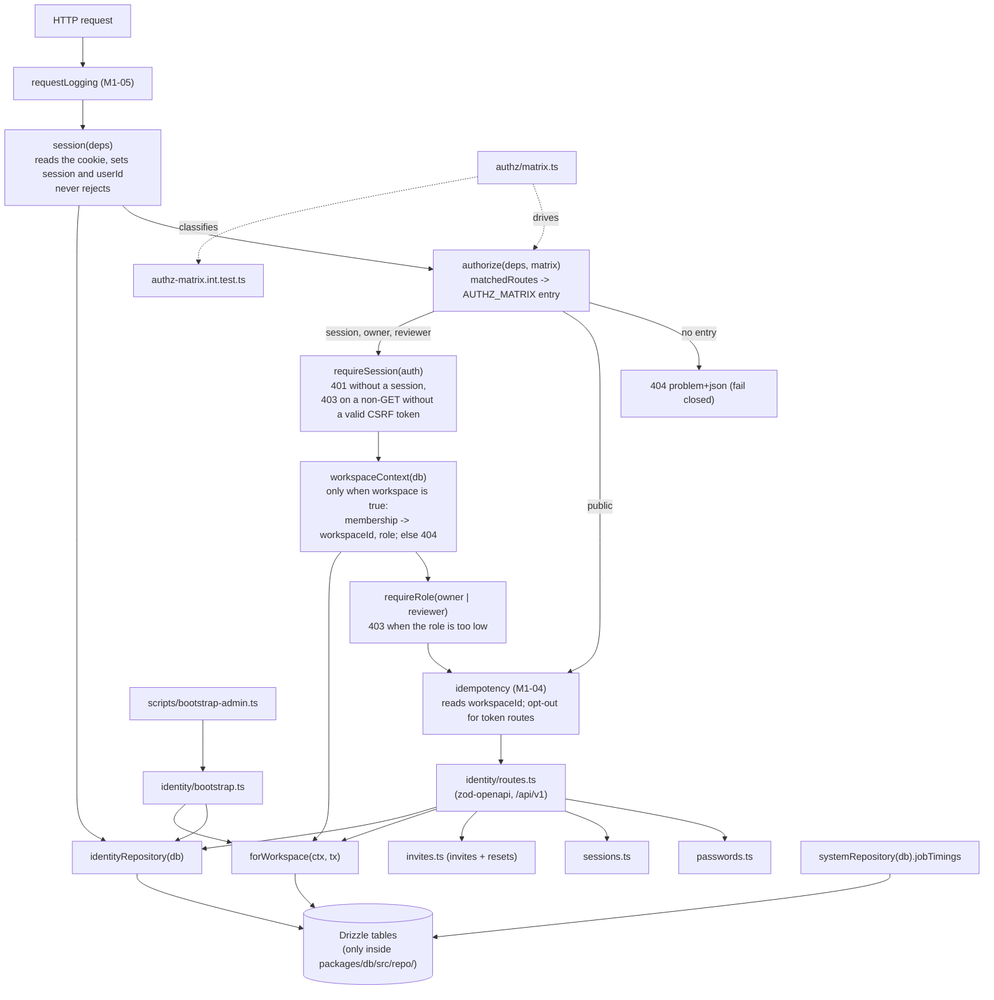
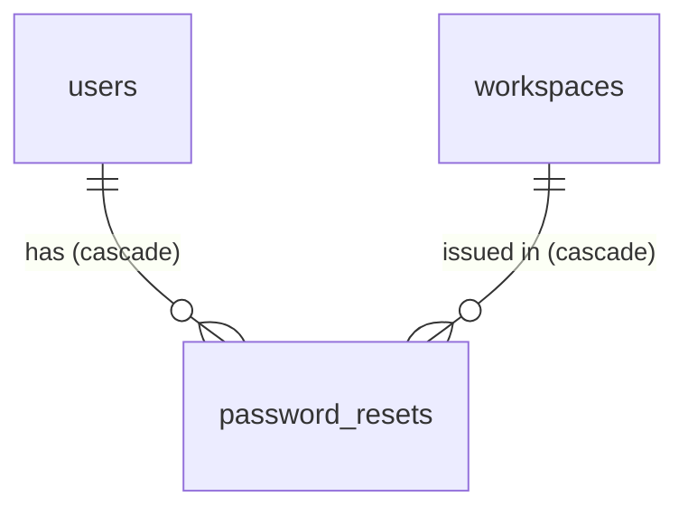

# Design Document

## Overview

M1-03 (ADR 0013, architecture §5 and §9) gives 4x35 its identity layer: invite-only accounts, argon2id
passwords, server-side sessions, CSRF protection, owner and reviewer roles enforced on the server, and a
workspace-scoped repository layer. The authZ matrix test over every route is the control against
information disclosure, and later tickets extend it.

Deliverables, by package:

- `packages/db/src/repo/{index,types,workspace,identity,system}.ts`: `forWorkspace`,
  `identityRepository`, `systemRepository`, `OutOfScopeError`. `@4x35/db` exports no Drizzle table.
- `drizzle/0003_password_resets.sql`: one new table, `password_resets`.
- `apps/server/src/identity/{passwords,sessions,csrf,invites,bootstrap,routes}.ts`.
- `apps/server/src/middleware/{session,workspace,role,problem}.ts`.
- `apps/server/src/authz/{matrix,enforce}.ts`.
- `apps/server/src/env.ts` (`readEnv`, `authConfig`) and the wiring in `apps/server/src/app.ts`.
- `apps/server/scripts/bootstrap-admin.ts`.
- Tests: `packages/db/test/{no-raw-tables.test.ts,repo-scope.int.test.ts}`,
  `apps/server/test/{identity.int.test.ts,authz-matrix.int.test.ts}`.

Out of scope (ticket): API tokens and scopes (M3-01), four-eyes (M2-17), login rate limits (M1-08), audit
events for identity actions (M1-08), sign-in and accept-invite screens (M1-07), email delivery.

## Architecture



### Decision: one `authorize` middleware driven by the matrix

`apps/server/src/authz/enforce.ts` exports `authorize(deps, matrix = AUTHZ_MATRIX)`. The app installs one
`authorize` for every route, so no route carries its own guard list that someone could forget. The
matrix is both the specification the test checks and the table the server enforces.

For each request, `authorize`:

1. Finds the handler route Hono matched with `matchedRoutes(c)` from `hono/route`: the last matched route
   whose method is not `ALL` (middleware registers as `ALL`). No matched route means Hono's own 404, and
   `authorize` calls `next()`.
2. Looks the route up with `routeKey(method, path)`, where `:id` becomes `{id}` and `HEAD` is treated as
   `GET`.
3. Answers 404 problem+json when the matched route has no matrix entry. This is the fail-closed rule: a
   route nobody classified is unreachable, and the matrix test also fails.
4. Passes a `public` route straight to the next middleware.
5. Otherwise runs, in order, `requireSession(auth)`, then `workspaceContext(db)` when the entry says
   `workspace: true`, then `requireRole('owner')` or `requireRole('reviewer')`. The first step that
   answers wins; the later steps do not run.

Tests pass an extended matrix as the second argument to mount a test-only route. The app always uses
the default.

### Decision: middleware order in `createApp`

`requestLogging`, `session`, `authorize`, `idempotency`, route. Each step reads what the previous one set:

1. `requestLogging` (M1-05) sets `requestId` and the logger.
2. `session(deps)` reads the `__Host-4x35_session` cookie, validates it with `validateSession` and sets
   `session` and `userId` when it is live. It never rejects: whether a route needs a session comes from
   the AuthZ_Matrix, applied by `authorize`.
3. `authorize` as above. It sets `workspaceId` and `role` for workspace routes. A malformed workspace
   id, a workspace that does not exist and a workspace the caller is not a member of all answer the
   same 404 body.
4. The M1-04 `idempotency` middleware reads `workspaceId` from the Hono context (its `workspaceOf`
   default), so `Idempotency-Key` handling is keyed by the workspace that authz resolved, never by a
   caller-supplied one. Routes with no workspace (login, logout, accept, password-reset) are not
   stored.
5. The route handler.

`createApp` installs `session` and `authorize` only when both `db` and `auth` are passed, and the
identity routes with them.

### Decision: no unscoped export except the identity lookups and `systemRepository`

`packages/db/src/index.ts` exports `export * from "./repo/index.js"` and no Drizzle table. The exports
that touch tables are `forWorkspace`, `identityRepository` and `systemRepository`, plus the row types
(type-only) and `OutOfScopeError`. Callers see repository methods, never table objects. The
`Schema` type that `@4x35/db` still exports from `client.ts` is a type, not a table.

### Decision: AuthZ matrix keyed by `"METHOD path"`

`apps/server/src/authz/matrix.ts` exports `AUTHZ_MATRIX: Readonly<Record<string, RouteClass>>` where
`RouteClass = { access: Access; workspace: boolean }` and `Access = "public" | "session" | MembershipRole`.
It also exports `routeKey`, `openApiPath`, `classify` and `inconsistentEntries`, which lists entries
that contradict themselves (an `owner` or `reviewer` entry without `workspace: true`, or a workspace
entry whose path has no `/workspaces/{id}`).

### Decision: invites and resets are single use through a row lock

A conditional `UPDATE ... WHERE used_at IS NULL` would let a failure after the update leave the token
spent while the account change rolled back, unless the update shared the transaction. The design uses
the transaction directly: the repository locks the usable row with `SELECT ... FOR UPDATE`, the service
does its work, and then `markInviteUsed` or `markResetUsed` sets `used_at = now()` in the same
transaction. Concurrent uses of one token serialise on the row lock, and the second sees the row as used.
A thrown error after the lock rolls the use back with everything else.

## Components and Interfaces

### Scoped_Repository_Layer (`packages/db/src/repo/`)

```ts
interface WorkspaceContext { readonly workspaceId: string }
type Executor = PgDatabase<NodePgQueryResultHKT, typeof schema>; // a Database or a Tx from withTx

function forWorkspace(ctx: WorkspaceContext, db: Executor): WorkspaceRepositories;
interface WorkspaceRepositories {
  workspaceId; workspace; memberships; invites; passwordResets; apiTokens; batches; records;
  proposals; decisions; auditEvents; exports; preflightRuns; paymentFileLinks; idempotencyKeys;
}
class OutOfScopeError extends Error {}
function identityRepository(db: Executor): IdentityRepository;
function systemRepository(db: Executor): SystemRepository;
```

Scoping rule per repository:

| Scope | Repositories | How the filter is applied |
|---|---|---|
| Direct column | `workspace` (by `id`), `memberships`, `invites`, `passwordResets`, `batches`, `auditEvents`, `idempotencyKeys`, `apiTokens` | `where workspace_id = ctx.workspaceId` on every select and update and delete; every insert writes `ctx.workspaceId` after the caller's values, so a workspace id in the input is overwritten (and `batches` and `auditEvents` inserts omit the field from their type) |
| Join to `batches` | `records`, `proposals`, `decisions`, `exports`, `preflightRuns`, `paymentFileLinks` | inner join to `batches` where `batches.workspace_id = ctx.workspaceId`; `records`, `exports` and `preflightRuns` join through `batch_id`, `paymentFileLinks` through `payment_batch_id`, and `proposals` and `decisions` join `records` and then `batches` |

A repository never builds a query without the filter, and no method takes a workspace id argument.

Malformed ids:

- `forWorkspace` throws `OutOfScopeError("workspace")` when `ctx.workspaceId` is not a UUID, so a
  context built from a bad value fails at construction, before any query.
- A method argument that is not a UUID (a row id, a batch id, a user id) matches nothing: `get`
  returns `undefined` and `list...` returns `[]`, with no Postgres cast error.

Writes that attach to a parent first check that the parent is in the context's workspace, through the
same join, and throw `OutOfScopeError` when it is not (or does not exist). Nothing is written. The
checks are: `records.insert` (batch), `proposals.insert` (record), `decisions.insert` (record and
proposal), `exports.insert` and `preflightRuns.insert` (batch), `paymentFileLinks.insert` (payment batch,
and the master record when given) and `passwordResets.create` (the user must be a member). A foreign
parent id cannot attach a row to another workspace's batch.

Unscoped exports (the only ones):

```ts
interface IdentityRepository {
  findUserByEmail(email: string): Promise<UserRow | undefined>;
  getUser(id: string): Promise<UserRow | undefined>;
  ensureUser(email: string): Promise<UserRow>;            // creates, or returns the existing user (citext)
  setPasswordHash(userId: string, hash: string): Promise<void>;
  membershipsOf(userId: string): Promise<UserMembership[]>;

  createSession(v: { idHash; userId; csrfSecret; expiresAt }): Promise<SessionRow>;
  findLiveSession(idHash: string): Promise<SessionRow | undefined>;  // not expired
  touchSession(idHash: string, expiresAt: Date): Promise<void>;
  deleteSession(idHash: string): Promise<void>;
  deleteUserSessions(userId: string): Promise<number>;

  lockUsableInvite(tokenHash: string): Promise<InviteRow | undefined>;   // SELECT ... FOR UPDATE
  markInviteUsed(id: string): Promise<void>;                             // used_at = now()
  lockUsableReset(tokenHash: string): Promise<PasswordResetRow | undefined>;
  markResetUsed(id: string): Promise<void>;

  firstWorkspace(): Promise<WorkspaceRow | undefined>;   // bootstrap: oldest non-sandbox workspace
  createWorkspace(name: string): Promise<WorkspaceRow>;  // bootstrap
  isOwner(workspaceId: string, email: string): Promise<boolean>; // bootstrap
}
interface SystemRepository {
  jobTimings: {
    insert(v: JobTimingInsert): Promise<void>;
    listByJob(jobId: string): Promise<JobTimingRow[]>;   // oldest first
  };
}
```

`lockUsable...` selects the row whose hash matches and whose `used_at` is null and `expires_at` is in the
future, and must be called inside a transaction. `membershipsOf` returns only the caller's own
memberships; `GET /me` uses it. `workspaceContext` does not use it: it calls
`forWorkspace({ workspaceId }, db).memberships.get(userId)` for the workspace in the path.
`systemRepository(db).jobTimings` is the one non-identity unscoped export: `job_timings` has no
workspace column and holds no content (M1-05).

`getBatchProgress(tx, workspaceId, batchId)` (`apps/server/src/jobs/progress.ts`, M1-04) now looks the
batch up through `forWorkspace` first and returns `undefined` for a batch outside the workspace, so
another workspace's batch id reveals no record or job counts.

### Table_Import_Guard (`packages/db/test/no-raw-tables.test.ts`)

A unit test (no database) that scans the TypeScript and JavaScript sources under `apps/`, `packages/`
and `integrations/` (skipping `node_modules`, `dist`, `build`, `coverage`, `.turbo` and `.d.ts` files)
and fails when a file imports the Drizzle tables outside the allow-list. An import counts when its
specifier resolves into `packages/db/src/schema/`, or when it brings the name `schema` from
`@4x35/db`, in any of the forms `import ... from`, `export ... from`, `import("...")` and bare `import
"..."`. The allow-list is explicit, each entry has a reason, and it is the whole list:

- `packages/db/src/repo/` (the repository layer),
- `packages/db/src/schema/` (the table definitions),
- `packages/db/src/client.ts` (registers the tables with Drizzle),
- `packages/db/src/mappers/` (type-only imports; a value import there fails),
- `packages/db/test/schema.test.ts` and `packages/db/test/schema.int.test.ts` (DDL tests),
- `packages/db/test/roundtrip.int.test.ts` (row round-trip test, M1-02).

`packages/db/drizzle.config.ts`, `migrate.int.test.ts` and `harness.ts` import nothing from the schema
and are not on the list. The guard has three tests:

1. The scanner finds each import form, shown with planted violations (strings built at run time, so the
   test file holds no import for the scan to find), and it applies the type-only rule to `mappers/`.
2. No file outside the allow-list imports the tables.
3. The public API of `@4x35/db` exports no Drizzle `Table` and no `schema` name.

A file on the list that stops needing the import stays until a ticket removes it; a new file never joins
the list without an edit to the test, which the reviewer sees.

### Migration `0003_password_resets.sql`

Generated with `drizzle-kit generate`. It creates `password_resets` (declared in
`packages/db/src/schema/identity.ts`): `id uuid pk default gen_random_uuid()`, `user_id uuid not null`
(foreign key to `users`, on delete cascade), `workspace_id uuid not null` (foreign key to `workspaces`,
on delete cascade), `token_hash text not null` with a unique constraint, `expires_at timestamptz(3) not
null`, `used_at timestamptz(3)`, `created_at timestamptz(3) not null default now()`, and indexes
`password_resets_user_idx` and `password_resets_workspace_idx`. No other schema change. `0001` and
`0002` are not edited.

### Password_Service (`apps/server/src/identity/passwords.ts`)

```ts
const ARGON2 = { algorithm: 2 /* argon2id */, memoryCost: 19456, timeCost: 2, parallelism: 1 } as const;
const MIN_PASSWORD_LENGTH = 12;
type PasswordCheck = "ok" | "too_short" | "equals_email";
function checkPassword(password: string, email: string): PasswordCheck;
function hashPassword(password: string): Promise<string>;
function verifyPassword(encoded: string, password: string): Promise<boolean>; // false for a malformed hash
function burnVerify(password: string): Promise<void>; // one verify against a fixed argon2id hash, result discarded
```

`@node-rs/argon2` 2.2.2, argon2id, the OWASP parameters (m=19456 KiB, t=2, p=1), set explicitly so a
library default change cannot weaken them. The algorithm is the number `2` because `Algorithm` is a
const enum that `verbatimModuleSyntax` cannot import. `checkPassword` NFC-normalises the password,
requires at least 12 code points, and rejects a password equal to the email after trim, NFC and lower
casing. The encoded `$argon2id$v=19$m=19456,t=2,p=1$...` string carries its own salt and parameters.
Passwords never reach a log: the request body is not logged (M1-05) and `redact()` censors keys that
contain `password`.

### Session_Service (`apps/server/src/identity/sessions.ts`)

```ts
const SESSION_COOKIE = "__Host-4x35_session";
const IDLE_MS = 12 * 3_600_000;
const ABSOLUTE_MS = 7 * 24 * 3_600_000;
const TOUCH_EVERY_MS = 60_000;
interface SessionConfig { sessionSecret: string; secureCookie: boolean }

function newSessionId(): string;                                  // 32 random bytes, base64url (43 characters)
function hashSessionId(id: string, sessionSecret: string): string; // HMAC-SHA256, hex
function idleDeadline(createdAt: Date, now: Date): Date;          // min(now + 12 h, createdAt + 7 d)
function createSession(db, cfg, userId, now?): Promise<{ id: string; row: SessionRow }>;
function validateSession(db, cfg, id, now?): Promise<SessionRow | null>;
function readSessionCookie(c): string | undefined;
function sessionCookieHeader(cfg, id, maxAgeSeconds): string;
function setSessionCookie(c, cfg, id): void;
function clearSessionCookie(c, cfg): void;
```

- Cookie: `__Host-4x35_session`, `HttpOnly`, `SameSite=Lax`, `Path=/`, no `Domain` (the `__Host-` prefix
  forbids it), `Max-Age` equal to the 7-day absolute lifetime, and `Secure` unless `secureCookie` is
  false. `secureCookie` is false only when `NODE_ENV=development` (`authConfig` in `env.ts`). The header
  is written by hand because the `hono/cookie` serializer refuses a `__Host-` cookie without `Secure`,
  and the ticket drops `Secure` only for plain http on localhost. Logout and password reset send the
  same cookie with `Max-Age=0`.
- Storage: `sessions.id_hash` holds `HMAC-SHA256(SESSION_SECRET, id)` as hex. The raw id exists only in
  the cookie. `sessions.csrf_secret` is a separate random value (see Csrf_Guard).
- Validation: `validateSession` returns null for an id that is not 43 base64url characters, for a row
  that `findLiveSession` does not return (unknown or past its `expires_at`), for a row whose
  `expiresAt <= now`, and for a row with `createdAt + ABSOLUTE_MS <= now`. The last check is direct, so
  the 7-day cap holds even if a stored idle deadline were ever past it.
- Sliding: `expires_at` is the idle deadline. Creation sets `idleDeadline(now, now)`. A validated request
  computes `idleDeadline(createdAt, now)` and writes it back with `touchSession` only when it is at least
  `TOUCH_EVERY_MS` later than the stored one, so a busy session costs at most one UPDATE per minute.
  Because of the `min`, a session used every hour still ends 7 days after creation. The clock is a
  parameter (`now`) so tests can move it.
- Rotation: login deletes the session whose cookie the request presented, if any, and creates a new one
  in one transaction, so a fixed pre-login id is useless.
- Logout deletes the row and sends the expired cookie. A password reset deletes every session of that
  user (`deleteUserSessions`).

### Csrf_Guard (`apps/server/src/identity/csrf.ts`)

```ts
const CSRF_HEADER = "X-CSRF-Token";
const SAFE_METHODS: ReadonlySet<string> = new Set(["GET", "HEAD", "OPTIONS"]);
function newCsrfSecret(): string;                                      // 32 random bytes, base64url
function csrfToken(csrfKey: string, sessionCsrfSecret: string): string; // HMAC-SHA256(CSRF_SECRET, secret), base64url
function csrfValid(csrfKey: string, sessionCsrfSecret: string, header: string | undefined): boolean;
```

`csrfValid` is false for an absent header, and otherwise compares the header with the expected token
using `crypto.timingSafeEqual` after checking that the lengths are equal (a length mismatch is false
without comparing).

The check is part of `requireSession(auth)`, so it applies to the routes the matrix classifies as
`session`, `owner` or `reviewer`: for a method not in `SAFE_METHODS`, a missing or wrong header answers
403 problem+json. It runs before `workspaceContext` and `requireRole`, so a forged request learns
nothing about workspaces. `GET /api/v1/me` returns the token of the caller's session.

Routes classified `public` (login, accept invite, password reset) are not CSRF-checked, even when the
request carries a session cookie: they are reached without a session, so they carry no ambient
credential to forge. A request with no session cookie, or with one that does not resolve to a live
session, is anonymous: a session route answers it with 401 and a public route serves it.

### Invite_Service and Reset_Service (`apps/server/src/identity/invites.ts`)

```ts
const INVITE_TTL_MS = 72 * 3_600_000;
const RESET_TTL_MS = 3_600_000;
function newToken(): string;                 // 32 random bytes, base64url
function hashToken(token: string): string;   // SHA-256, hex

type IssueInviteResult = ({ kind: "issued" } & IssuedToken) | { kind: "already_member" };
function issueInvite(db, workspaceId, email, role, now?): Promise<IssueInviteResult>;

type AcceptResult =
  | { kind: "accepted"; userId; workspaceId; role }
  | { kind: "gone" }
  | { kind: "weak_password"; reason: "too_short" | "equals_email" }
  | { kind: "wrong_password" };
function acceptInvite(db, token, password): Promise<AcceptResult>;

type IssueResetResult = ({ kind: "issued" } & IssuedToken) | { kind: "not_member" };
function issueReset(db, workspaceId, userId, now?): Promise<IssueResetResult>;

type RedeemResult =
  | { kind: "reset"; userId; sessionsEnded: number }
  | { kind: "gone" }
  | { kind: "weak_password"; reason: "too_short" | "equals_email" };
function redeemReset(db, token, password): Promise<RedeemResult>;
// IssuedToken = { id: string; token: string; expiresAt: Date }
```

Tokens are 32 random bytes, base64url. Only `SHA-256(token)` hex is stored (`invites.token_hash`,
`password_resets.token_hash`); the plain token is returned once, in the response of the issuing call.

Single use is enforced by a row lock, as described in the decision above. `acceptInvite` runs in one
transaction: `lockUsableInvite`, then the user, then the membership, then `markInviteUsed`. A used,
expired or unknown token gives `gone`, and the route answers `410` problem+json for all three, so the
response does not reveal which applied. `redeemReset` runs `lockUsableReset`, the password check,
`setPasswordHash`, `deleteUserSessions` and `markResetUsed` in one transaction.

Accepting an invite for an address that already has a password (an account that is a member of another
workspace) requires that account's current password. A wrong one gives `wrong_password` and the route
answers `401` with the login failure body; the invite stays usable. An invite token alone therefore
cannot take over an existing account. A new user (no account, or an account with no password yet) sets a
password under the password policy; a weak one gives `weak_password` (`422`) and the invite stays
usable.

`issueInvite` returns `already_member` (`409`) when the address is already a member of the workspace. It
checks membership before inserting, so the route does not depend on a unique-violation error.
`issueReset` returns `not_member` (`404`) for a `userId` that is not a member of the owner's workspace,
the same status as a non-member workspace.

### Routes (`apps/server/src/identity/routes.ts`)

All routes use `createRoute` from `@hono/zod-openapi` under `/api/v1` (`API_PREFIX`); request and
response bodies are zod schemas, so input is validated at the trust boundary and the OpenAPI registry
lists every route. A body or parameter that fails its schema answers a fixed `400` problem (the app's
`defaultHook`), never the zod message, which can quote the input. Handlers read the workspace from
`c.var.workspaceId` (set by `authorize`) and never from the body.

| Route | Access | Workspace | Notes |
|---|---|---|---|
| `POST /auth/login` | public | no | sets the cookie; same status and body for unknown email, no password yet, and wrong password |
| `POST /auth/logout` | session | no | deletes the session row, clears the cookie, 204 |
| `GET /me` | session | no | user, memberships, CSRF token |
| `POST /workspaces/{id}/invites` | owner | yes | returns the one-time token, 201; 409 for an existing member |
| `POST /invites/accept` | public | no | token and password; 410 when used, expired or unknown |
| `POST /workspaces/{id}/members/{userId}/reset-link` | owner | yes | one-time token, 1 h, 201; 404 for a non-member |
| `POST /password-reset` | public | no | token and new password; ends all sessions of the user, 204 |
| `PATCH /workspaces/{id}/members/{userId}` | owner | yes | changes the role |

Login: look up the user by email through `identityRepository`. When the user is unknown, or has no
password hash yet, run `burnVerify` (one argon2id verify with the same parameters), so time matches;
every failure path returns `401` with the same problem+json body, which has no field that depends on
the cause.

Role change guard: `PATCH .../members/{userId}` refuses to demote the last owner of a workspace (`409`
problem+json). This is not a new requirement: it keeps the owner-only routes reachable. The check and
the update run in one transaction. A `userId` that is not a member answers `404`.

### Idempotency opt-out

`IDENTITY_IDEMPOTENCY_OPT_OUT` in `apps/server/src/app.ts` lists the two routes whose response carries a
raw one-time token: `/api/v1/workspaces/{id}/invites` and
`/api/v1/workspaces/{id}/members/{userId}/reset-link`. `createApp` passes the list, with any
`deps.idempotencyOptOut`, as `optOut` to the M1-04 middleware, so a request with an `Idempotency-Key` to
these routes is neither stored nor replayed, and the token never lands in `idempotency_keys`. Every other
authenticated workspace POST is replayed under its key, scoped to the workspace that authz resolved.

### Auth_Middleware (`apps/server/src/middleware/` and `authz/enforce.ts`)

```ts
function session(deps: { db; auth }): MiddlewareHandler<AuthEnv>;       // cookie -> session, userId; never rejects
function requireSession(auth: AuthConfig): MiddlewareHandler<AuthEnv>;  // 401, or 403 on CSRF failure
function workspaceContext(db: Database): MiddlewareHandler<AuthEnv>;    // /workspaces/{id}: membership -> workspaceId, role; else 404
function requireRole(needed: "owner" | "reviewer"): MiddlewareHandler<AuthEnv>;
function roleAllows(actual: MembershipRole | undefined, needed: MembershipRole): boolean;
function authorize(deps, matrix?): MiddlewareHandler<AuthEnv>;           // authz/enforce.ts
function problem(c, status, detail?): Response;                          // RFC 9457
function problemBody(status, detail?): Problem;
const PROBLEM_TITLES: Record<ProblemStatus, string>;                    // 400 401 403 404 409 410 422
```

- `AuthConfig` is `SessionConfig` plus `csrfSecret`.
- `roleAllows` ranks `reviewer` below `owner`, so `requireRole('owner')` allows owners only and
  `requireRole('reviewer')` allows reviewers and owners (the owner role includes reviewer rights; the
  matrix test asserts both cells).
- `workspaceContext` takes the workspace id from the request path with `/workspaces/([^/]+)`, requires a
  UUID, and looks the caller up with `forWorkspace({ workspaceId }, db).memberships.get(userId)`. A
  missing user, a path with no workspace, a malformed id and a non-member all answer `404` "No such
  workspace." It then sets `workspaceId` (lower case) and `role`.
- Status codes: 401 no or invalid session, 403 role too low or CSRF failure, 404 non-member workspace,
  malformed workspace id, unclassified route or a `userId` outside the workspace, 410 used or expired
  token. Every one is `application/problem+json` with `type: "about:blank"`, a title from
  `PROBLEM_TITLES` and, when a detail is given, a constant string that never echoes request content.
- `problem()` is the single constructor for auth errors, so the body never varies with input.

### Logging (M1-05 allow-list)

No new field joins `LOGGED_FIELDS`. The request line keeps `userId` and `workspaceId` (already in
`REQUEST_FIELDS`). Passwords, session ids, CSRF tokens, invite and reset tokens, and emails are not
logged by this ticket's code. `redact()` censors keys containing `password` or `token`. The invite URL
is not in a request log because the token is only in the JSON response body, and the bootstrap script
writes it to stdout only. An invite fragment (`#token=...`) never reaches the server.

### AuthZ_Matrix test (`apps/server/test/authz-matrix.int.test.ts`)

Test names start with `authz matrix`:

1. **Enumerate.** `servedRoutes(app)` takes the paths and methods from the OpenAPI document
   (`app.getOpenAPI31Document`) and, in addition, every non-`ALL` entry of Hono's `app.routes`, so a
   route added with plain `app.get` is seen. Health routes (`/healthz`, `/readyz`) are classified
   `public`. A served route with no matrix entry fails the test, and an entry with no served route
   fails it too. `inconsistentEntries()` must be empty.
2. **Fail closed.** A test mounts an unclassified `GET /api/v1/unclassified` route on a second app. The
   enumeration reports it as unclassified, and a request to it as an owner answers 404 and not the
   handler's body.
3. **Cells.** One test per matrix entry, named with the route key. Each runs four callers against a
   seeded database with two workspaces: anonymous, an owner of the other workspace, a reviewer of the
   target workspace and an owner of the target workspace. A caller with a session sends the cookie and
   a valid `X-CSRF-Token` through the `call` helper, so a CSRF 403 cannot mask an authorization
   decision. A permitted cell must answer 2xx. A forbidden cell must answer 401, 403 or 404 with
   `application/problem+json`, never 200.
4. **Foreign ids** (three tests whose names contain `P-cross-workspace-denied`), for the workspace
   routes, called by workspace A's owner: (a) workspace B's id in the path answers 404 and leaves B's
   invites, resets and workspace row unchanged; (b) B's member id under A's workspace path answers 404
   and leaves a snapshot of B unchanged; (c) B's ids in the query string and in body arrays (`ids`,
   `workspaceId`, `userIds`) are never acted on or returned: the response does not contain any of
   them, and the snapshot of B is unchanged.

### Bootstrap_Script (`apps/server/src/identity/bootstrap.ts`, `apps/server/scripts/bootstrap-admin.ts`)

`npm run bootstrap:admin -w apps/server` runs `tsc -b && node scripts/bootstrap-admin.ts` (Node's own
type stripping runs the script, which imports the built `dist/identity/bootstrap.js`).

Environment. The script uses `DATABASE_URL`, `BOOTSTRAP_ADMIN_EMAIL` and `APP_BASE_URL`. For each of
these three that is unset or empty, it takes the value from the repo's `.env` (the main checkout's
`.env` when run from a git worktree, found through `git rev-parse --git-common-dir`). A variable that
is already set wins, and no other key is loaded. `BOOTSTRAP_ADMIN_EMAIL` must be an email address and
`APP_BASE_URL`, when present, a URL; a failure prints `bootstrap:admin: invalid environment: <key names>`
to stderr and exits 1, with no values. `DATABASE_URL` is read by `databaseUrl()` from `@4x35/db`.

Logic (`bootstrapAdmin(db, { email, baseUrl?, now? })`). Inside one transaction, after
`pg_advisory_xact_lock(hashtext('4x35:bootstrap-admin'))` so concurrent runs cannot interleave:

1. Take the oldest non-sandbox workspace, or create one named `Main workspace`.
2. When the address is already an owner of it, return `owner_exists`.
3. When an unused, unexpired owner invite for the address exists, return `pending`. The URL cannot be
   printed again: only the hash is stored.
4. Otherwise create an owner invite valid 72 hours and return `invited` with the URL
   `<APP_BASE_URL>/invite#token=<token>` (trailing slashes of the base are removed). With no
   `APP_BASE_URL` the URL is the relative `/invite#token=<token>`.

Output. The script prints to stdout, once, and nowhere else:

- `invited`: `owner invite (one-time, 72 h): <url>`. When `APP_BASE_URL` is unset it also writes
  `bootstrap:admin: APP_BASE_URL is not set; the link is relative` to stderr.
- `pending`: `pending owner invite exists for the bootstrap admin; nothing created`.
- `owner_exists`: `bootstrap admin is already an owner; nothing created`.

The email is never printed or logged, the token sits in a URL fragment so it reaches no server log, and a
failure writes `bootstrap:admin: failed (<error class>)` to stderr and sets exit code 1. Run twice, the
database holds one workspace and one pending invite. An expired invite is not pending: the next run
issues a fresh one.

## Data Models

Existing tables from M1-02 (`workspaces`, `users`, `memberships`, `invites`, `sessions`) are unchanged.
`users.password_hash` is nullable until an invite is accepted. New table (migration
`0003_password_resets.sql`):



Environment values are validated in `apps/server/src/env.ts`. `readEnv` parses `NODE_ENV`, `MODE`,
`PORT`, `LOG_LEVEL`, `COMMIT`, `DATABASE_URL`, `SESSION_SECRET`, `CSRF_SECRET` and `APP_BASE_URL`, and
throws with key names only. `SESSION_SECRET` and `CSRF_SECRET` are each at least 32 characters. `authConfig(env)` requires both,
requires them to differ, and returns `{ sessionSecret, csrfSecret, secureCookie }` with `secureCookie`
false only for `NODE_ENV=development`; a missing or equal value throws with the key names only.
`BOOTSTRAP_ADMIN_EMAIL` is read by the bootstrap script, not by `readEnv`.

## Correctness Properties

*A property is a characteristic or behavior that should hold true across all valid executions of a
system, essentially a formal statement about what the system should do. Properties serve as the bridge
between human-readable specifications and machine-verifiable correctness guarantees.*

Requirements 2 to 3 and 5 to 10 are single scenarios, fixed constants or boundaries; they are tested as
examples and edge cases (see Testing Strategy). Requirement 11 is a table-driven matrix over a finite
route set, also an example suite. The two requirements that state a rule over an unbounded input space
become properties. Both keep the ticket's ID verbatim. The ticket gives P1 `numRuns` 200; it names none
for P2, which uses the workflow minimum of 100.

### Property 1: Cross-workspace reads are denied (P1, P-cross-workspace-denied)

FOR ALL pairs of distinct workspaces A and B, all rows of B in every workspace-owned table, and all
resource IDs (those of B's rows, those of A's rows, random UUIDs and malformed ids), THE
Scoped_Repository_Layer SHALL satisfy: no repository call made through `forWorkspace` with A's
Workspace_Context returns a row of B.

**Validates: Requirements 1.1, 1.3**

- **Tests**: `packages/db/test/repo-scope.int.test.ts`, two property tests and one positive control.
  - `P1 P-cross-workspace-denied: no repository call with workspace A's context returns a row of
    workspace B (200 runs)`: the read property.
  - `P1 P-cross-workspace-denied: every write that would attach to workspace B's rows throws
    OutOfScopeError and writes nothing`: for every write in the `WRITES` table (the child inserts and
    `passwordResets.create`) and every batch or record id of B, the call rejects with `OutOfScopeError`
    and B's batch list has the same length before and after. This test uses 50 runs; it covers a small
    finite set and is the write half of Requirement 1.1, not a second use of the ticket's 200.
  - `positive control: workspace A's own ids are found through A's context`: every read in `READS`
    returns at least one row for A's own ids, so the property cannot pass because every call returns
    nothing.
- **numRuns**: the read property runs `NUM_RUNS` from `packages/db/test/arbitraries.ts`, which is
  `Math.max(200, Number(process.env.FC_NUM_RUNS ?? 0) || 0)`: at least the ticket's 200, raised by
  `FC_NUM_RUNS`. The planted-bug run uses the same `NUM_RUNS`.
- **As built**: a real Postgres through the db Test_Harness. Two workspaces, each with a connected
  graph (members, invites, reset links, API tokens, batches, records, proposals, decisions, audit
  events, exports, preflight runs, payment file links, idempotency keys), are seeded once in
  `beforeAll`, and an index maps every seeded row id to its workspace. Each run picks one read from
  `READS` (every `get` and `list...` method of every repository) and an id, calls it with
  `forWorkspace({ workspaceId: A }, db)`, and fails when any returned row id belongs to B.
- **Domain arbitraries**: no bare `fc.string()`. The seeded address lines come from the shared
  `addressLine` arbitrary in `packages/db/test/arbitraries.ts` (CJK, Devanagari, Arabic, Cyrillic, Latin
  with diacritics, NFC and NFD, whitespace runs of three or more, tabs, non-breaking spaces, lengths
  around 15/16/17, 34/35/36 and 69/70/71) and the same lines are written to A and B, so identical
  content in both cannot hide a leak by value. The id arbitrary is weighted: B's id of the kind the call
  expects (weight 4), any id of B, any id of A, a random `fc.uuid()`, and the junk values `"not-a-uuid"`,
  `""` and the nil UUID (weight 1 each).
- **Planted bug**: `records.get` without the workspace filter (it falls back to another workspace's
  record, as an unscoped `where id = $1` would). Test `P1 catches a planted bug: records.get without the
  workspace filter`.
  - Counterexample: a `records.get` call with a workspace B record id
    (`[["records.get","13887234-ba2d-4385-ac22-80113740f98e"]]`).
  - Seed: 3032.
  The real repository is restored and the property passes at 200 runs.

### Property 2: CSRF token is required on every non-GET session route (P2, P-csrf-required)

FOR ALL non-GET routes that need a session and all `X-CSRF-Token` header values (absent, empty, a token of
another session, a case-changed token, a token with a trailing `=`, a token with one character changed,
a truncated token, or the valid token), THE Csrf_Guard SHALL satisfy: the response is 403 whenever the
header is not exactly the valid token of the request's session, and the response is 2xx when it is.

**Validates: Requirements 4.3, 4.4**

- **Tests**: `apps/server/test/identity.int.test.ts`.
  - `P2 P-csrf-required: every non-GET session route is 403 without a valid X-CSRF-Token and succeeds
    with one (100 runs)`.
  - `P2 P-csrf-required catches a planted bug: CSRF checked on POST only`.
- **numRuns**: `P2_RUNS`, which is `Math.max(100, Number(process.env.FC_NUM_RUNS ?? 0) || 0)`. The
  planted-bug run uses `P2_RUNS` too.
- **As built**: the route list comes from the AuthZ_Matrix (every route whose access is not `public` and
  whose method is not in `SAFE_METHODS`), so a route added later is covered without editing the test.
  The test also asserts the current list (`PATCH .../members/{userId}`, `POST /auth/logout`,
  `POST .../invites`, `POST .../reset-link`). A real app, a real database and a logged-in owner. Each
  run picks a route and a seed. With the bad header the status must be 403; with the valid header the
  same kind of request, with fresh targets, must be 2xx. A response of any other status throws an error
  that names the route and the header.
- **Domain arbitraries**: `csrfHeader(valid, otherValid)` is `fc.oneof` of: absent, the empty string,
  another session's valid token, the valid token in upper case, the valid token plus `=`, the valid
  token with the character at a random position replaced, and the valid token with its last character
  removed. The route is `fc.constantFrom` over the matrix routes. Bodies are fixed valid bodies, because
  the property is about the header and the route.
- **Planted bug**: CSRF checked on POST only. Test `P2 P-csrf-required catches a planted bug: CSRF
  checked on POST only` builds the same app with a session step that checks the token only when the
  method is POST.
  - Counterexample: the PATCH member route (`["PATCH /api/v1/workspaces/{id}/members/{userId}",0]`).
  - Seed: 4242.
  The real guard is restored and the property passes at 100 runs.

## Error Handling

- **Authentication and authorization** (all RFC 9457 problem+json, generic body per status): 401 no or
  invalid or expired session; 403 role too low or CSRF failure; 404 non-member workspace, malformed
  workspace id, unclassified route, or a `userId` outside the workspace; 410 used, expired or unknown
  invite or reset token.
- **Login**: unknown email, no password yet and wrong password all give the same 401 body; the first two
  burn one argon2 verify so timing matches. Accepting an invite with the wrong password for an existing
  account gives the same 401 body.
- **Schema validation**: a body or parameter that fails its zod schema gives `400` with a fixed detail,
  never the zod message.
- **Password policy**: too short or equal to the email gives `422` problem+json with the fixed detail
  "Use at least 12 characters, and not your email address.", no echo of the password. The invite or
  reset token stays usable.
- **Transactions**: accept-invite and reset-redeem run in one transaction each, holding the token row
  lock. An error thrown after the lock rolls back everything, including the use of the token, so a
  failed redeem leaves the token usable until it expires.
- **Role change and invites**: demoting the last owner gives `409`; inviting an existing member gives
  `409`. The latter is decided by a membership check in `issueInvite`, not by catching a unique
  violation.
- **Cookie and secret handling**: a malformed cookie value, or one that does not hash to a live session
  row, is the same as no session. A missing, short or equal `SESSION_SECRET` and `CSRF_SECRET` stops the
  process at start-up with the key names only.
- **Repository writes**: a write that names a parent in another workspace throws `OutOfScopeError`; the
  route layer never passes a caller-supplied parent without the check in the repository.
- **Unhandled errors** go to `app.onError` (M1-05): class only, generic 500.

## Testing Strategy

Property-based testing applies to the repository scope rule (P1) and the CSRF rule (P2): behaviour over
a large generated input space. It does not apply to cookie attributes, TTL constants, argon2 parameters
or the matrix, which are fixed configuration or finite tables; those use examples.

**Property tests** (fast-check 4.10.2, vitest, real Postgres):

- P1 in `packages/db/test/repo-scope.int.test.ts` (200 runs minimum, the write test at 50, a positive
  control, and the planted bug at seed 3032).
- P2 in `apps/server/test/identity.int.test.ts` (100 runs minimum, and the planted bug at seed 4242).

The property ID is in each test name. Each property has its planted bug and counterexample recorded
above; the planted-bug tests assert that the property fails on the wrong code and print the seed and
counterexample.

**Unit test, no database** (`packages/db/test/no-raw-tables.test.ts`, run by `npm test -w packages/db`):
the Table_Import_Guard, three tests as described under that component.

**Integration tests** (`apps/server/test/identity.int.test.ts`, real Postgres, through the HTTP app).
Passwords, sessions and the rest were built into this one file rather than separate unit files. It covers:

- passwords: the argon2id prefix and parameters (`m=19456,t=2,p=1`), verify true and false and a
  malformed hash, 11 characters rejected and 12 accepted, an 11-code-point and a 12-code-point CJK
  password, and equality with the email in mixed case;
- login: identical status, body and content type for a wrong password, an unknown email and an account
  with no password yet, and no cookie on failure;
- the cookie: `__Host-4x35_session` with `HttpOnly`, `Secure`, `SameSite=Lax`, `Path=/` and no `Domain`;
  `Secure` dropped under `NODE_ENV=development` (and `authConfig` for development, test and production);
  rotation of a presented session; `GET /me` with user, memberships and a token that `csrfValid`
  accepts;
- logout deletes the row and the old cookie then gets 401;
- expiry: `idleDeadline` at creation and near the cap; a session past its idle deadline gets 401; a
  session at 7 days minus 30 minutes slides to the cap and not to +12 h, is valid 1 s before the cap
  and null 1 ms after; a fresh session's deadline slides forward on use;
- invites: the 72-hour expiry, a weak password gives 422 and leaves the token usable, accept works once,
  a second accept is 410 with problem+json, login works with the new password, an expired invite is 410,
  an unknown token is 410, an invite for an existing member's address is 409;
- an invite for an existing account needs that account's password (`wrong_password`, no takeover);
- resets: a reset link works once and ends every session of the user, an expired link is 410, a link for
  a non-member is 404;
- role change by an owner, and the refusal to demote the last owner (409);
- hashes only: after login, an invite (with and without an `Idempotency-Key`) and a reset, a dump of
  every public table finds none of the raw cookie, session id or tokens, and finds the HMAC and the
  SHA-256 hash;
- P2 and its planted bug;
- idempotency: an authenticated POST on a test-only route is replayed (`Idempotent-Replayed` header,
  one handler run), and the invite route with an `Idempotency-Key` stores nothing in
  `idempotency_keys` (the opt-out);
- bootstrap: `bootstrapAdmin` twice gives one workspace and one pending owner invite, the URL matches
  `https://app.example.test/invite#token=<43 characters>` and does not contain the email, accepting the
  printed link makes the owner and a third run gives `owner_exists`; three concurrent runs create one
  workspace and one invite.

**AuthZ matrix test** (`apps/server/test/authz-matrix.int.test.ts`): as described under that component:
enumeration, the fail-closed unclassified route, one test per matrix entry with the four callers, and
three `P-cross-workspace-denied` foreign-id tests.

**Repository scope example tests** (`packages/db/test/repo-scope.int.test.ts`): the write test and the
positive control above. The batch-progress scoping is tested in `apps/server/test/jobs.int.test.ts`
(M1-04): `getBatchProgress` returns `undefined` for a batch of another workspace and for an unknown id.

**Not covered by a test in this ticket.** These checks were in the earlier design and have no test:

- A capturing-logger test that no log line contains a password, token, cookie or email during identity
  requests. M1-05's `P1 P-logs-carry-no-content` test and the logger's redaction test cover bodies,
  cookies and headers in general, but no test drives the identity routes against a capturing logger.
- Two concurrent accepts (or redeems) of one token racing on the row lock. Sequential reuse (410) is
  tested; the lock is not.
- Rollback of the token use when an error is thrown after the lock. The weak-password case returns
  normally and leaves the token usable, which is tested; a thrown error is not.
- Fixed problem+json bodies per status. The login failure bodies are compared, and the matrix test checks
  the content type, but no test compares `problemBody` output across statuses or inputs.
- The 12-hour idle boundary at 1 ms either side. The idle expiry is tested with a deadline 1 s in the
  past, and the 7-day cap is tested at 1 s before and 1 ms after.
- A 13-character password boundary (11 and 12 are tested).
- The `bootstrap-admin.ts` script itself: `.env` loading (including from a worktree), the printed strings,
  the stderr note and exit codes. Only `bootstrapAdmin` is tested.
- A test that a request with a valid cookie but no CSRF header to a public route is served (the
  public routes carrying a session are not exercised).
- `roleAllows` and `workspaceContext` have no direct unit tests; they are covered through the matrix test.

**Commands**: `npm test -w packages/db` (the Table_Import_Guard and the other db unit tests),
`npm run test:integration -w packages/db -- --reporter=verbose` (P1) and
`npm run test:integration -w apps/server -- --reporter=verbose` (P2 and the matrix). The validation gate
greps the verbose output for `P-cross-workspace-denied`, `P-csrf-required` and `authz matrix`. Both
integration scripts need `DATABASE_URL`; the tests skip without it. `npx tsc -b apps/server/test
packages/db/test` type-checks the tests.

**Dual coverage rationale**: the examples pin the exact status codes, TTLs and cookie attributes of the
requirements; the two properties cover the input spaces examples cannot exhaust (every repository read
against every resource id, every non-GET session route against every malformed token).
