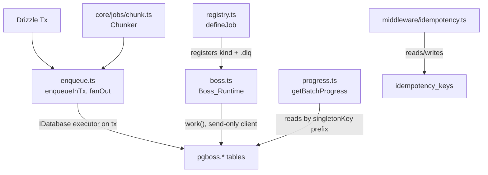

# Design Document

## Overview

M1-04 (ADR 0005, ADR 0006) builds the async foundation: pg-boss 12.38.2 in the same Postgres, jobs
enqueued inside the caller's Drizzle transaction, chunked work (≤ 200 IDs), idempotent handlers,
jittered retries, dead-lettering, batch progress polling, and an `Idempotency-Key` middleware on
POSTs. Real pipeline jobs, logging/`job_timings`, the dead-letter admin route and the HTTP status
endpoint are out of scope.

## Architecture



## Components and Interfaces

### Boss_Runtime (`boss.ts`)
Decision (not a requirement): `MODE=web` is a send-only pg-boss client.
- `startBoss(options: StartBossOptions): Promise<JobRuntime>` with `options = { connectionString,
  mode, db, pollingIntervalSeconds?, poolMax?, onError? }`. It calls `boss.start()`, then for every
  defined kind creates the queues and, for `worker`/`all`, registers one `work()` handler that runs
  the job in its own `withTx` transaction. For `web` it constructs `PgBoss` with `supervise: false,
  schedule: false` and never calls `work()`. The instance is also the one `enqueueInTx` sends through
  (`activeBoss()`); one runtime per process.
- `JobRuntime = { boss, runsWorkers, workerIds, stop() }`. `stop()` calls
  `boss.stop({ graceful: true, close: true, timeout: 25_000 })` and is safe to call twice.
- `startProcess(env, info, options): Promise<ProcessHandle>` in `apps/server/src/process.ts` starts
  the pool, `startBoss`, and the HTTP listener only when the mode serves HTTP. `worker` mode never
  binds `PORT`. `stop()` closes HTTP, drains jobs, ends the pool. `main.ts` calls it on SIGTERM.

### Enqueuer / Fan_Out (`enqueue.ts`)
```ts
function txExecutor(tx: Tx): Db; // pg-boss's own fromDrizzle(tx, sql)
function singletonKey(key: JobKey): string; // `${batchId}/${base64url(packRef)}/${step}/${chunk}`
async function enqueueInTx(tx: Tx, kind: string, payload: unknown, key: JobKey): Promise<string | null>;
async function fanOut(tx: Tx, batchId: string, step: string, ids: readonly string[],
  options: { kind: string; packRef: string; payload?: (recordIds: string[], chunk: number) => unknown },
): Promise<(string | null)[]>;
```
`enqueueInTx` validates the payload against the kind's schema, then calls `activeBoss().send(kind,
data, { singletonKey, db: txExecutor(tx) })`. The executor is pg-boss's own `fromDrizzle(tx, sql)`
adapter (not `sql.raw`), so pg-boss's INSERT runs on the caller's transaction with bound parameters
and rolls back with it. It returns the job id, or `null` when a job with the same key is already
queued, retrying or active. Retry settings live on the queue, not on `send`. `fanOut` chunks `ids`
with the Chunker and calls `enqueueInTx` once per chunk (key chunk index `i`, default payload
`{ recordIds }`), returning the ids in order. Decisions (not requirements): job data is `{ key,
payload }`; the singletonKey format above (pg-boss keys allow only `[\w.\-/]`, hence base64url).

### Chunker (`packages/core/src/jobs/chunk.ts`, pure)
```ts
function chunk<T>(ids: readonly T[], size: number = CHUNK_SIZE): T[][]; // CHUNK_SIZE = 200; RangeError unless size is a positive integer
```
No I/O, no imports beyond the language — lives in `packages/core` per the boundary rule.

### Job_Registry (`registry.ts`)
```ts
function defineJob<S extends ZodType>(spec: { kind: string; schema: S; handler: (ctx: JobContext<z.infer<S>>) => Promise<void>; retryDelaySeconds?: number }): JobDefinition;
// JobContext<P> = { tx, payload, jobId, key }; JobDefinition = { kind, deadLetter, retryLimit, retryDelaySeconds, schema, handler }
```
`defineJob` only records the definition (and returns it); it throws on an invalid or duplicate kind.
`startBoss` creates the queues for every defined kind: `<kind>.dlq` *before* `<kind>` (pg-boss
resolves `deadLetter` at creation time), then `<kind>` with `{ deadLetter, retryLimit: 3,
retryDelay: 2, retryBackoff: true, policy: "exclusive" }`, and `updateQueue` to refresh an existing
queue. Decisions (not requirements): policy `exclusive`; DLQ-first creation. Retry waits follow
pg-boss's equal jitter, `R·2^n/2 + R·2^n/2·random()` after the n-th failure, so they increase and
differ; full jitter was rejected because it cannot guarantee increasing delays (R5.1). The worker
parses the job data (`{ key, payload }`), validates `payload` with the kind's schema (a bad payload
throws, counting as a failed attempt), opens a `withTx` transaction, calls the handler with `{ tx,
payload, jobId, key }`, commits. Handlers upsert by `(record, pack ref, step)` as a contract checked
by `P-handler-idempotent`, not enforced mechanically. No `Test_Job` is registered from product
code; it lives only in test files.

### Progress_Query (`progress.ts`)
```ts
interface BatchProgress {
  records: Record<string, number>; // by records.status
  jobs: { queued: number; active: number; failed: number; dead: number };
}
async function getBatchProgress(tx: Tx, batchId: string): Promise<BatchProgress>;
```
`jobs` comes from one query over `pgboss.job` filtered to work queues (`name` not ending in
`.dlq`) and `singleton_key LIKE '<batchId>/%'`, counted by `state`: `created` → `queued`, `active`
→ `active`, `retry` → `failed`, and `failed` → `dead`. A job that fails its last attempt stays in
the work queue with state `failed` (and is copied to `<kind>.dlq`), so counting the work queue
counts it once; rows in `.dlq` are not counted.

### Idempotency_Middleware (`middleware/idempotency.ts`)
`idempotency({ db, workspaceOf?, optOut? }): MiddlewareHandler`, applied to every POST by
`createApp` when given the database. `optOut` is a list of `{ path, reason }` (R7.4). Steps, in
order (the 409 / 5xx / no-workspace / 24 h-stale rules are design decisions, not requirements):
1. Not a POST, no `Idempotency-Key` header, or an opted-out path → pass through.
2. No resolved `workspace_id` → pass through, table untouched. A malformed key → `400` problem+json.
3. `request_hash` is sha256 over method, path and body bytes.
4. Delete an entry for `(workspace_id, key)` older than 24 h, then claim the key by inserting a
   pending placeholder with `ON CONFLICT DO NOTHING`.
5. Claim lost: a row with a different `request_hash` → `422` problem+json; a row still pending →
   `409` problem+json; a completed row → return the stored status, content type and body with
   `Idempotent-Replayed: true`, handler not invoked.
6. Claim won: run the handler, then store `{status, contentType, body}` and set `at = now()`. A
   5xx response or a thrown error deletes the placeholder, so a retry runs again.

Uses the `idempotency_keys` shape from the `persistence` spec (`key, workspace_id, request_hash,
response, at`); this ticket only reads/writes it.

## Data Models

`JobKey = { batchId: string; packRef: string; step: string; chunk: number }`. pg-boss's own
`pgboss.job`/`pgboss.schedule`/`pgboss.version` tables are managed by pg-boss migrations, not
this ticket's Drizzle schema (`docs/architecture.md` §5: "pg-boss schema — managed by pg-boss").
`idempotency_keys` is defined in the `persistence` spec's `ops.ts` module; this ticket consumes it.

## Correctness Properties

*A property is a characteristic or behavior that should hold true across all valid executions of
a system — a formal statement about what the system should do. Properties serve as the bridge
between human-readable specifications and machine-verifiable correctness guarantees.*

Requirements 1 (MODE lifecycle), 4.1–4.3/4.6 (registry wiring), 5.2–5.4 (retry/DLQ config), 6
(progress counts), 7.1/7.4/7.5 (storage, opt-out, default scope) and 8 (test environment) vary little
with input and are tested as examples. Three requirements state a universal rule over an
unbounded input space and become properties below, each with the ticket's own ID kept verbatim.

### Property 1: Chunking covers every ID once, in order (P-chunking-covers-once)

FOR ALL lists of up to 20,000 IDs, THE Chunker SHALL satisfy: every returned chunk has length ≤
200, and concatenating the returned chunks in order yields a list identical to the input (same
elements, same order, none dropped, none duplicated).

**Validates: Requirements 3.1, 3.2**

- **Test**: `packages/core/test/chunk.property.test.ts`, test name contains `P-chunking-covers-once`.
- **Library**: fast-check 4.10.2. `numRuns`: `Math.max(500, Number(process.env.FC_NUM_RUNS ?? 0) ||
  0)` — at least the ticket's 500.
- **Domain arbitrary**: `recordIds` derives every ID from one `fc.uuid({ version: 4 })` by a
  12-hex index suffix (distinct, `records.id` shape, cheap for 20,000 draws). The length is drawn
  from `fc.oneof` of the boundaries (0, 1, 199, 200, 201, 399, 400, 401, 19,999, 20,000), `k·200 + d`
  with `d` in {-1, 0, 1}, and a uniform integer in 0..20,000.
- **Planted bug**: the slice end one short, `ids.slice(start, start + size - 1)`, which drops the
  last ID of every full chunk. Built as: seed 4041, caught after 1 run, counterexample length 399
  (`P-chunking-covers-once: planted bug caught after 1 runs; seed=4041; counterexample length=399`).
  The real chunker is in place and the properties pass (4 tests in `chunk`).

### Property 2: Handler replay is idempotent (P-handler-idempotent)

FOR ALL chunk jobs built from a Job_Key and a valid payload for a registered kind, THE Job_System
SHALL satisfy: running the handler for that job once, recording the resulting rows, then forcing
a second run of the same job (same `jobId`, same payload) SHALL leave the database rows for that
`(record, pack ref, step)` set identical (deep-equal) to the rows after the first run.

**Validates: Requirements 4.4, 4.5**

- **Test**: `apps/server/test/jobs.int.test.ts`, test name contains `P-handler-idempotent`, run
  against a real Postgres and pg-boss (Test_Job registered only in this file).
- **Library**: fast-check 4.10.2 inside a vitest integration test. `numRuns` is 20: each run
  enqueues and completes two real pg-boss jobs (about 1 s), so the 100 used by P3 and the 500 of P1
  are not affordable here. The ticket names no `numRuns` for this property (only P1's ≥ 500), so
  20 meets it (reviewer, M1-04).
- **Domain arbitrary**: `chunkPayload` builds distinct record IDs (`fc.uniqueArray(fc.uuid({ version:
  4 }), { minLength: 1, maxLength: 200 })`) with an address-line value per ID from the shared
  `addressLine` arbitrary (`packages/core/test/arbitraries.ts`: CJK, Devanagari, Arabic, Cyrillic,
  Latin-with-diacritics, NFC/NFD, whitespace runs).
- **Planted bug**: a Test_Job handler that `INSERT`s a result row instead of upserting by
  `(record, pack ref, step)`, so a forced replay produces a duplicate row. Built as: seed 4042,
  caught after 1 run, 8 records in the counterexample (`P-handler-idempotent: planted bug caught
  after 1 runs; seed=4042; records in counterexample=8`). The upsert handler is in place and the
  property passes.

### Property 3: Idempotency key replay is response-stable (P-idempotency-key-replay)

FOR ALL POST requests carrying an `Idempotency-Key` and a JSON body, THE Idempotency_Middleware
SHALL satisfy: (a) replaying the identical key and body returns a status and body deep-equal to
the first (non-5xx) response, without invoking the route handler a second time; (b) replaying the
same key with a different body returns `422` problem+json.

**Validates: Requirements 7.2, 7.3**

- **Test**: `apps/server/test/idempotency.int.test.ts`, test name contains
  `P-idempotency-key-replay`, against a real Postgres.
- **Library**: fast-check 4.10.2 inside vitest. `numRuns`: `Math.max(100, Number(process.env.FC_NUM_RUNS ?? 0) || 0)`.
- **Domain arbitrary**: `fc.uuid({ version: 4 })` keys; request bodies are `fc.record` values with
  address-line arrays (the shared `addressLine` arbitrary) and an integer count; a second body for
  the 422 branch is generated to differ from the first.
- **Planted bug**: the route opted out of the middleware, so a replay runs the handler again and
  the stored response is never used. Built as: seed 4043, caught after 1 run
  (`P-idempotency-key-replay: planted bug caught after 1 runs; seed=4043;
  key=f9a418aa-a8fd-4a82-9651-a37e7320fe01`). The middleware is applied and the property passes.

## Error Handling

- **Rollback on enqueue**: `enqueueInTx` issues no SQL outside the caller's transaction; a thrown
  error after it rolls back the whole transaction, taking the pg-boss insert with it (R2.2).
- **Schema validation failure**: an invalid payload throws unwrapped from `.parse`; pg-boss
  counts it as a failed attempt like any handler throw, so it still retries and dead-letters
  rather than being silently dropped (never invent — a malformed job is surfaced, not discarded).
- **Handler throw**: pg-boss marks the attempt failed and schedules the next per `retryBackoff`;
  after attempt 4 the job moves to `<kind>.dlq` (R5.1, R5.3).
- **Idempotency conflict (`409`)**: returned before the handler runs; the in-flight row is left
  untouched (design decision).
- **Graceful shutdown timeout**: if active jobs do not finish within 25 s of SIGTERM, `stopBoss`
  resolves anyway and the process exits; an uncommitted handler transaction rolls back naturally
  on connection loss.

## Testing Strategy

**Unit/integration examples**: empty/single-ID/exactly-200 chunk inputs, Job_Key →
`singletonKey` formatting, MODE startup behavior (`web` binds no workers; `worker` binds no
`PORT`), DLQ-before-queue ordering, same-key double-enqueue yielding one row, an always-throwing
handler attempted 4 times with strictly increasing non-identical delays, `getBatchProgress`
counts across all job/record states, a 409 on concurrent same-key requests, and a stale (> 24 h)
row being replaced.

**Property tests**: the three properties above, one fast-check test each (ID in the test name),
run under `npm run test -w packages/core -- chunk` (P1, no DB) and `npm run test:integration -w
apps/server` (P2, P3, real Postgres and pg-boss, per Requirement 8).

**Dual coverage rationale**: examples pin exact acceptance-criteria wording (retry counts, state
transitions, HTTP codes); the properties cover the unbounded input spaces examples cannot exhaust.
