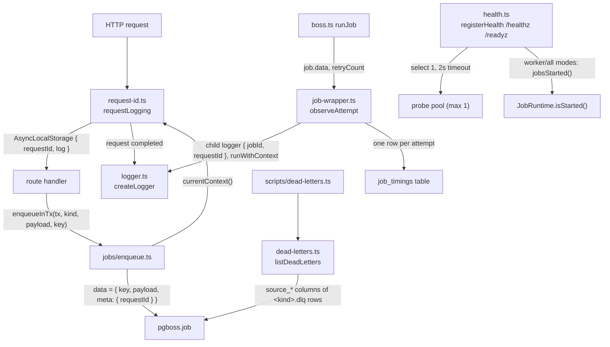

# Design Document

## Overview

M1-05 (ADR 0015, architecture §9) gives 4x35 its observability baseline: pino JSON logs carrying
request and job correlation IDs and no file content (R8: addresses are personal data), one
`job_timings` row per job attempt, a dead-letter listing that never selects payload, and a Render
health check. Tracing, metrics endpoints, APM and the owner-only dead-letter HTTP route are out of
scope (ADR 0015, M1-08).

## Architecture



## Components and Interfaces

### Logger (`apps/server/src/obs/logger.ts`)
```ts
interface LoggerConfig {
  readonly level: LogLevel | "silent"; // LOG_LEVEL, or "silent" for a logger that writes nothing
  readonly destination?: DestinationStream; // default stdout; tests pass a capturing stream
}
function createLogger(config: LoggerConfig): Logger;
function silentLogger(): Logger;
const serializers: { req; job; err };
function redact(value: unknown, depth?: number): unknown;
function errorClass(err: unknown): string;
const REQUEST_FIELDS, JOB_FIELDS, LOGGED_FIELDS, CENSOR;
```
`createLogger` wraps pino 10.4.0 and writes JSON lines in every `NODE_ENV` (ISO `time`, level as a
label, no `base` bindings, no pretty transport and no `pretty` option). Three layers keep content
out of a line:
- **Allow-list.** `formatters.log` (and `formatters.bindings`) run `allowListed`, which keeps only
  the top-level keys in `LOGGED_FIELDS` (`req`, `job`, `err`, `requestId`, `jobId`, `kind`, `mode`,
  `port`, `workers`, `http`, `version`, `commit`, `signal`, `checks`, `count`), drops every other
  key and adds `droppedFields: <count>` when it dropped any.
- **Serializers.** `req` and `job` call `pick(fields, raw)`, which builds a **new** object field by
  field from `REQUEST_FIELDS` (method, route, status, durationMs, requestId, userId, workspaceId,
  userAgent) or `JOB_FIELDS` (kind, jobId, batchId, chunk, attempt, outcome, ms) and keeps scalar
  values only (string, number, boolean). They never spread the input. `err` emits `{ type:
  errorClass(err) }`.
- **Redaction.** Pino's `redact` option is not used. `redact()` is a custom recursive walker (depth
  limit 8, deeper values become `"[redacted]"`) applied by `allowListed` to every non-serialized
  top-level value, e.g. `checks`. It censors keys matching `password` or `token` anywhere in the
  name, keys starting with `original` or `lines`, and `name` at any depth below the top level.
- **`logMethod` hook.** Every call is reduced to `(fields, message)`. A string-first call logs the
  string alone, so printf-style values are never interpolated. An `Error` first argument becomes
  `{ err }` with the constant message `"error"`, so pino never writes `err.message` or the stack.
`errorClass` returns `err.name` (or the constructor name when `name` is `"Error"`), and
`"UnnamedError"` unless it is an identifier of at most 64 characters, `"NonError"` for non-objects.

### Request correlation (`apps/server/src/obs/request-id.ts`)
```ts
const REQUEST_ID = /^[A-Za-z0-9-]{8,64}$/;
const REQUEST_ID_HEADER = "X-Request-Id";
function requestIdFrom(header: string | undefined | null): string; // header if well formed, else randomUUID()
interface RequestContext { readonly requestId: string | null; readonly log: Logger; }
function currentContext(): RequestContext | undefined;
function runWithContext<T>(ctx: RequestContext, fn: () => T): T;
function requestLogging(logger: Logger): MiddlewareHandler<ObsEnv>; // Hono
interface ObsEnv { Variables: { requestId: string; log: Logger; userId?: string; workspaceId?: string } }
```
On each request `requestLogging` takes `requestIdFrom(X-Request-Id)`: the incoming value only when
`REQUEST_ID` matches, otherwise a fresh UUID, and the incoming value is discarded. It sets
`requestId` and a child logger `log` on the Hono context and runs `next()` inside
`runWithContext({ requestId, log })` (an `AsyncLocalStorage`), so `enqueueInTx` reads the id through
`currentContext()` without it being threaded through signatures. After `next()` it sets the response
header `X-Request-Id` and logs one `request completed` line with `req: { method, route, status,
durationMs, userId, workspaceId, userAgent }`. `route` is the matched pattern from `hono/route`
`routePath(c, -1)`, never the raw path or query string; a 404 that matched only the `*` middleware
is logged as `(unmatched)`. Other request headers, the body and cookies are never read for logging.

`app.onError` (in `app.ts`) logs `{ err }` through the request's logger, so only the error class is
written, and answers a generic `500 application/problem+json`. Hono's default handler is replaced
because it prints the error message and stack to stderr.

### Correlation into jobs (`apps/server/src/jobs/enqueue.ts`, `registry.ts`)
```ts
const JobMeta = z.object({ requestId: z.string().regex(REQUEST_ID_SHAPE).optional() });
const JobData = z.object({ key: JobKey, payload: z.unknown(), meta: JobMeta.optional() });
```
`enqueueInTx` reads `currentContext()?.requestId` and, when it is set, stores `meta: { requestId }`
next to `{ key, payload }` in the pg-boss job data; otherwise it omits `meta`. A job's own handler
runs inside `runWithContext` with the job's `requestId`, so a job that enqueues another job passes
the id on. `key`, `payload` and per-kind payload validation (`defineJob`) are unchanged.

### Job wrapper (`apps/server/src/obs/job-wrapper.ts`)
```ts
type JobOutcome = "completed" | "failed" | "dead_letter";
interface AttemptInfo {
  kind: string; jobId: string;
  retryCount: number; retryLimit: number; // pg-boss retryCount: 0 on the first attempt
  batchId: string | null; chunk: number | null; requestId: string | null;
}
function failureOutcome(retryCount: number, retryLimit: number): JobOutcome; // retryCount >= retryLimit ? "dead_letter" : "failed"
async function observeAttempt(db: Database, logger: Logger, info: AttemptInfo, run: () => Promise<void>): Promise<void>;
```
`runJob` in `jobs/boss.ts` parses `JobData` (`safeParse`, so bad data still yields a timing row),
builds `AttemptInfo` from the job id, `retryCount`, the kind's `retryLimit` from its definition
and the key and `meta.requestId`, and passes the handler (parse, validate payload, `withTx`) as
`run`. `observeAttempt`:
1. Builds a child logger bound to `jobId` (and `requestId` when known) and runs `run` inside
   `runWithContext({ requestId, log })`.
2. Measures `ms` with `performance.now()` around `run`.
3. Chooses the outcome: `completed`, or on a throw `failureOutcome(retryCount, retryLimit)`. With
   `retryLimit` 3 the fourth attempt (`retryCount` 3) is the `dead_letter` one.
4. After `run` has settled (its own transaction committed or rolled back), inserts one
   `job_timings` row on `db` in a separate statement, so a rolled-back attempt still leaves its row.
   An insert failure is logged (class only) and never changes the job outcome.
5. Logs one `job attempt` line: `job: { kind, jobId, batchId, chunk, attempt: retryCount + 1,
   outcome, ms }`, at `info` on success, `warn` on a failure that will retry, `error` on
   `dead_letter`, with `err` as the class only.
6. Rethrows the original error, so M1-04 retry, backoff and dead-lettering are unchanged.

### Health endpoints (`apps/server/src/obs/health.ts`)
```ts
type CheckResult = "ok" | "unavailable" | "timeout" | "not configured";
interface Readiness { status: "ready" | "unavailable"; checks: { database: CheckResult; jobs?: CheckResult } }
interface ReadinessProbe { database: (() => Promise<void>) | null; jobsStarted?: () => boolean }
function createProbePool(connectionString: string): pg.Pool;
function selectOne(pool: pg.Pool): () => Promise<void>;
async function readiness(probe: ReadinessProbe | undefined): Promise<Readiness>;
function registerHealth(app: Hono, info: BuildInfo, probe?: ReadinessProbe): void;
```
`GET /healthz` returns `200 { status: "ok", version, commit }` and never touches the database.
`GET /readyz` runs `probe.database` (built by `selectOne(createProbePool(DATABASE_URL))`) raced
against a 2 s timer (`READY_TIMEOUT_MS`). The `database` check is `ok` when the probe resolves,
`unavailable` when it rejects (connection or query error), `timeout` when the timer wins, and
`not configured` when there is no probe (the route then answers 503). The probe pool has `max: 1`,
2 s connection, statement and query timeouts and swallows pool `error` events, so a saturated app
pool or a dropped connection cannot crash the process or cause a false "not ready". In `worker` and
`all` modes `startProcess` also passes `jobsStarted: () => jobs.isStarted()`, and `checks.jobs` is
`ok` or `unavailable`; `web` mode omits it. `JobRuntime.isStarted()` is true from a successful start
until `stop()` is called. The response is `200 { status: "ready", checks }` when every check is `ok`,
otherwise `503 { status: "unavailable", checks }`. Both routes carry no data beyond status, version
and commit. Registering them as `public` in the AuthZ_Matrix belongs to M1-03: no matrix exists in
the code yet, so no test here asserts it.

### Dead letters (`apps/server/src/obs/dead-letters.ts`)
```ts
interface DeadLetter { kind: string; jobId: string; batchId: string | null; attempts: number; errorClass: string; deadAt: Date }
async function listDeadLetters(tx: Tx, options?: { limit?: number }): Promise<DeadLetter[]>; // limit 1..1000, default 100
function formatDeadLetters(list: readonly DeadLetter[]): string;
```
`listDeadLetters` reads the `<kind>.dlq` rows of `pgboss.job` (`name like '%.dlq'` and `source_id is
not null`) and selects only: `source_name` (kind), `source_id` (original job id), `data -> 'key' ->>
'batchId'`, `coalesce(source_retry_count, 0) + 1` (attempts), `source_output ->> 'name'` (the error
class name, passed through `errorClass`; `UnnamedError` when absent) and `created_on` (`deadAt`).
No query selects `data`, `output` or `source_output` as a whole, so neither the payload nor an error
message reaches the result. Newest first by `created_on`, at most `limit` rows. It returns `[]` when
`pgboss.job` does not exist yet. `formatDeadLetters` returns a header line `kind\tjob_id\tbatch_id\tattempts\terror_class`
followed by one tab-separated line per row (`-` for a null batch id), newline-terminated; `deadAt`
is not printed. `apps/server/scripts/dead-letters.ts` (`npm run jobs:dead-letters -w apps/server`,
which runs `tsc -b && node scripts/dead-letters.ts`) opens a one-connection pool, runs
`listDeadLetters` in `withTx`, writes `formatDeadLetters` to stdout and `dead letters: <n>` to
stderr, takes an optional limit argument, and on failure writes the error class only and sets exit
code 1. The pool is always closed.

## Data Models

No new tables: `job_timings` already exists (`packages/db/src/schema/ops.ts`, columns `job_id`,
`kind`, `batch_id`, `chunk`, `ms`, `outcome` constrained to `completed | failed | dead_letter`).
`JobData` (`apps/server/src/jobs/registry.ts`) gains the optional `meta: { requestId }`; `key` and
`payload` are unchanged. `RequestContext`, `AttemptInfo` and `DeadLetter` are in-memory types,
never persisted.

## Correctness Properties

*A property is a characteristic or behavior that should hold true across all valid executions of
a system — a formal statement about what the system should do. Properties serve as the bridge
between human-readable specifications and machine-verifiable correctness guarantees.*

Requirements 1 (level and JSON config), 6 (health scenarios), 7 (dead-letter listing), 8
(render.yaml) and 9 (spec and usage records) are fixed configurations or single scenarios; they are
tested as examples. The remaining requirements state a rule over an unbounded or combinatorial
input space and become properties P1 to P4. P1 keeps the ticket's own ID verbatim. A dead-letter
property (P5 in the first draft) is not a property as built; see "Dead-letter listing" below.

### Property 1: Logs carry no content (P1, P-logs-carry-no-content)

FOR ALL requests whose body, query string, headers and file name, and jobs whose payload, contain
a Marker_String drawn from Latin-with-diacritics, CJK and Devanagari text, THE Logger SHALL emit no
captured log line containing any Marker_String.

**Validates: Requirements 3.1**

- **Test**: `apps/server/test/logging.int.test.ts`, test name contains `P-logs-carry-no-content`.
- **numRuns**: 50 (the ticket's minimum); the planted-bug check also uses 50.
- **As built**: real requests and a real job (real Postgres and pg-boss) against a logger writing
  to an in-memory stream. `markerString` combines Latin with diacritics (NFC and NFD), CJK and
  Devanagari text with ASCII padding, placed in a request body, query string, extra header, file
  name or job payload field.
- **Planted bug**: the request serializer logs the raw URL including its query string as the route.
  Result from the verbose run: `P-logs-carry-no-content: planted bug caught after 1 runs;
  seed=5051; counterexample query marker="東्QSRLYQNRWG"`.

### Property 2: Request ID is accepted, generated, echoed and consistent (P2)

FOR ALL incoming `X-Request-Id` header values (absent, matching `^[A-Za-z0-9-]{8,64}$`, or not
matching that pattern) and for all log lines a request's handling writes, THE request logging
middleware and Logger SHALL satisfy: the response `X-Request-Id` header equals the incoming value
when it matches the pattern, equals a freshly generated value otherwise, and every log line written
during that request's handling carries a `requestId` equal to that header value.

**Validates: Requirements 4.1, 4.2, 4.3, 4.4, 4.6**

- **Test**: `apps/server/test/logging.int.test.ts`, test name `P2 request id round trip: ...`.
- **numRuns**: 200; the planted-bug check also uses 200.
- **As built**: a Hono app with a capturing logger; `requestIdHeader` is absent, well formed, or
  malformed (too short, too long, newline, space, `<`, control characters). Folded headers on the
  wire are covered by an example test (AC 3).
- **Planted bug**: the middleware echoes the incoming header verbatim. Result: `P2 request id round
  trip: planted bug caught after 3 runs; seed=5052; counterexample={"v":"Lxwo","ok":false}`.

### Property 3: One `job_timings` row per attempt, outcome matches attempt position (P3)

FOR ALL job attempt sequences of length 1 to `retryLimit + 1` (a success on some attempt, or
`retryLimit + 1` consecutive failures), THE Job wrapper SHALL insert exactly one `job_timings` row
per attempt, with the outcome of every failed attempt before the last being `failed`, the outcome of
a successful attempt being `completed`, and the outcome of a final failing attempt at position
`retryLimit + 1` being `dead_letter`.

**Validates: Requirements 5.3, 5.4, 5.5**

- **Test**: `apps/server/test/job-timings.int.test.ts`, test name `P3 one job_timings row per
  attempt, outcome by attempt position`.
- **numRuns**: 100; the planted-bug check also uses 100.
- **As built**: the test calls `observeAttempt` directly on a real database, once per simulated
  attempt with `retryCount` 0 to `retryLimit`, and reads the `job_timings` rows back. It does not
  drive pg-boss retries (that would need real backoff delays on every run). `attemptPlan` is a
  success at attempt `k` in 1..`retryLimit + 1`, or failure on every attempt; chunk is 0..50. The
  end-to-end path through pg-boss (1 row for a success, 4 rows for a dead-letter) is covered once
  by the AC 4 example test.
- **Planted bug**: the timing row is inserted inside the handler's transaction, so a failed
  attempt's row rolls back. Result: `P3 one row per attempt: planted bug caught after 1 runs;
  seed=5053; counterexample=[null,0]`.

### Property 4: Serializers emit only allow-listed fields (P4)

FOR ALL request log inputs and job log inputs, including inputs carrying extra fields outside the
allow-list (a raw body, a query string, a header map, a file name), THE Log_Serializer SHALL produce
an output object whose keys are a subset of the allow-list for that kind and whose values are
scalars (method, route, status, durationMs, requestId, userId, workspaceId, userAgent for a request;
kind, jobId, batchId, chunk, attempt, outcome, ms for a job).

**Validates: Requirements 2.1, 2.2, 2.3, 2.4**

- **Test**: `apps/server/test/logger.test.ts` (a unit test, no database), test name `P4 serializers
  emit only allow-listed scalar fields (req and job, 1000 runs each)`.
- **numRuns**: 1000 per serializer (`serializers.req` and `serializers.job`).
- **As built**: `fc.record` of the allow-listed fields plus `fc.dictionary` extra keys, including
  CJK and Devanagari values.
- **Planted bug**: a serializer that spreads the raw input. Result: `P4 allow-listed fields: planted
  bug caught after 1 runs; seed=5054` (the check runs up to 200 runs).

### Dead-letter listing (example check, not a property)

The first draft had a property P5 (bounded, complete, payload-free listing, 50 runs). It is not a
property as built, because each dead letter needs 4 real pg-boss attempts with backoff, so 50 runs
(each seeding up to 30 dead letters) is not runnable. The check is an example in
`apps/server/test/job-timings.int.test.ts`, the AC 4 test: one job fails 4 times and dead-letters;
the test then asserts the listing honours `limit`, returns no payload field (the marker in the
payload never appears) and carries the error class only, and runs `npm run jobs:dead-letters` to
check the printed line. Its output in the verbose run is `kind job_id batch_id attempts
error_class` followed by `test.timings-dead <id> <id> 4 SyntheticParseError`. Because it is not a
property, it has no planted-bug record.

## Error Handling

- **Request context absent**: `currentContext()` returns `undefined` outside a request (a script);
  `enqueueInTx` omits `meta` rather than throwing, and a job with no `meta.requestId` logs without
  a `requestId`.
- **Malformed `X-Request-Id`**: never echoed; a fresh UUID is used for the header and every line.
- **Unhandled route error**: `app.onError` logs the error class only and answers a generic 500.
- **Readiness**: a connection error or query error gives `database: unavailable`, a 2 s timeout
  gives `database: timeout`, and no probe gives `not configured`; all return 503 and never an
  unhandled rejection. A stopped `pg-boss` in a worker mode gives `jobs: unavailable`.
- **`job_timings` insert failure**: logged (class only); the handler's original error is still
  rethrown, or the success stands.
- **Dead-letter query**: returns `[]` when `pgboss.job` does not exist or there are no dead
  letters. `limit` outside 1..1000 is rejected by the zod options schema.
- **`jobs:dead-letters` script**: with no dead letters it prints the header line and
  `dead letters: 0` on stderr; a database error prints the error class only and exits 1.

## Testing Strategy

**Unit tests** (`apps/server/test/logger.test.ts`, `app.test.ts`, no database): JSON lines with ISO
time and label level, top-level allow-list with `droppedFields`, `req` and `job` scalar picking,
each redaction path (including inside `checks`), error class only, no printf interpolation,
`errorClass`, `requestIdFrom`, `/healthz`, `/readyz` with no database (503) and with a fake probe,
and P4.

**Integration tests** (`apps/server/vitest.integration.config.ts`, real Postgres):
- `logging.int.test.ts`: P1, P2, request id carried into a job (AC 2), newline and folded header
  replaced (AC 3).
- `job-timings.int.test.ts`: the AC 4 example (1 row for a success, 4 for a dead-letter, the
  dead-letter listing and CLI output) and P3.
- `health.int.test.ts`: a real process with Postgres behind a TCP proxy: `/readyz` 200 with the
  stack up; 503 in 11 ms with Postgres stopped and 503 in about 2 s with Postgres not answering,
  both within 3 s while `/healthz` stays 200; `/readyz` 200 again when Postgres is back; 503 with
  `jobs: unavailable` when pg-boss is stopped in a worker mode.

Run with `npx vitest run --config vitest.integration.config.ts --root apps/server --reporter=verbose
logging health job-timings` (the `--config` path is relative to `--root`).

**Dual coverage rationale**: examples pin exact scenarios (redaction paths, HTTP codes, timing
thresholds, the CLI line); the four properties cover unbounded input spaces (marker placement and
script, header validity, attempt position, extra fields on a log input). Not covered here: the
`render.yaml` health check path (Requirement 8), which waits for M0-07's blueprint.
