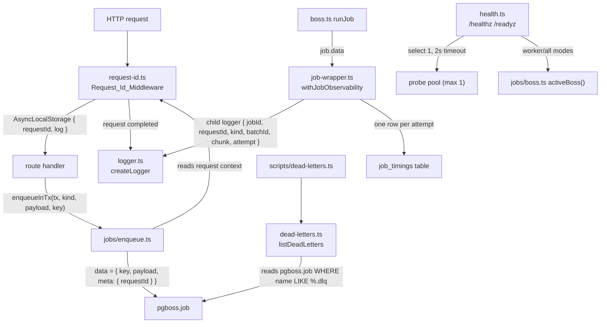

# Design Document

## Overview

M1-05 (ADR 0015, architecture §9) gives 4x35 its observability baseline: pino JSON logs carrying
request and job correlation IDs and no file content (R8: addresses are personal data), one
`job_timings` row per job attempt, a dead-letter listing that never selects payload, and a Render
health check. Tracing, metrics endpoints, APM and the owner-only dead-letter HTTP route are out of
scope (ADR 0015, M1-08).

## Architecture



## Components and Interfaces

### Logger (`apps/server/src/obs/logger.ts`)
```ts
interface CreateLoggerOptions {
  readonly level: string; // LOG_LEVEL
  readonly pretty?: boolean; // non-production convenience; still JSON, no transport dependency
  readonly destination?: pino.DestinationStream; // test capture
}
function createLogger(options: CreateLoggerOptions): pino.Logger;
function requestSerializer(req: RequestLogInput): RequestLogFields;
function jobSerializer(job: JobLogInput): JobLogFields;
```
`createLogger` wraps pino 10.4.0. In `NODE_ENV=production` it writes raw JSON; there is no pretty
transport dependency, so `pretty` elsewhere is cosmetic only and still emits JSON-safe fields — no
separate code path can leak an un-serialized object. Both serializers build a **new** object field
by field from the allow-list (Requirement 2); they never spread or forward the input object, so an
unlisted field on the input can never reach the log line by construction, not by deletion.
- `RequestLogFields = { method, route, status, durationMs, requestId, userId?, workspaceId?, userAgent? }`
- `JobLogFields = { kind, jobId, batchId?, chunk?, attempt, outcome?, ms? }`
`redact` is configured with the paths `password`, `token`, `*.original*`, `*.lines*`, `*.name`,
censor `"[redacted]"` — a defense-in-depth layer behind the allow-list, since those paths can only
appear at all if something is passed directly to `pino` outside the two serializers (e.g. a direct
`log.error(err)` call elsewhere in the codebase).

### Request_Id_Middleware (`apps/server/src/obs/request-id.ts`)
```ts
const REQUEST_ID_RE = /^[A-Za-z0-9-]{8,64}$/;
interface RequestContext { readonly requestId: string; readonly log: pino.Logger; }
const requestContext: AsyncLocalStorage<RequestContext>;
function requestIdMiddleware(logger: pino.Logger): MiddlewareHandler; // Hono
function currentRequestContext(): RequestContext | undefined; // read from anywhere, e.g. enqueueInTx
```
On each request: read `X-Request-Id`; accept it as the Request_Id only if `REQUEST_ID_RE` matches,
otherwise generate one (`crypto.randomUUID()`) and discard the incoming value. Set the response
header `X-Request-Id` to that value before the body is sent, including on thrown/error responses.
Bind `{ requestId, log: logger.child({ requestId }) }` into `requestContext` for the lifetime of
the request (Hono middleware wraps `await next()` in `requestContext.run(...)`), so any code called
during the request — including `enqueueInTx` — can read the same `requestId` without it being
threaded through every function signature. After the handler returns (or throws), log one `request
completed` line through `requestSerializer`: method, the **matched route pattern** (Hono's
`c.req.routePath`, e.g. `/batches/:id`, never the raw path or its query string), status,
`durationMs`, `requestId`, `userId`/`workspaceId` when the auth middleware set them, and the
`user-agent` header. The raw path, query string and any other header are never passed to the
serializer, which only accepts the listed fields as parameters — there is no object reference the
serializer could spread to leak them.

### Correlation into jobs (`apps/server/src/jobs/enqueue.ts`, extended)
```ts
export const JobData = z.object({ key: JobKey, payload: z.unknown(), meta: z.object({ requestId: z.string() }).optional() });
```
`enqueueInTx` reads `currentRequestContext()` before calling `activeBoss().send`; when a request
context is present it sets `meta: { requestId }` next to `{ key, payload }` in the pg-boss job
data. A job enqueued from outside a request (a future scheduled/system job) has no `meta` and the
Job_Wrapper logs without a `requestId`. `JobData` gains the optional `meta` field; existing callers
and the registry's payload validation are unaffected because `meta` is not part of the zod schema
a `defineJob` kind validates — only `key` and `payload` are.

### Job_Wrapper (`apps/server/src/obs/job-wrapper.ts`)
```ts
interface AttemptResult { readonly outcome: "completed" | "failed" | "dead_letter"; readonly ms: number; readonly errorClass?: string; }
async function withJobObservability(
  db: Database, def: JobDefinition, id: string, raw: unknown, attempt: number, retryLimit: number,
  logger: pino.Logger,
): Promise<void>;
```
Called from `runJob` in `apps/server/src/jobs/boss.ts` around the existing `withTx` handler call,
with `attempt` and `retryLimit` read from the pg-boss job record (`job.retryCount`, `job.retryLimit`,
already present on every job pg-boss delivers). It:
1. Parses `JobData` (now carrying optional `meta.requestId`) and builds a child logger
   `logger.child({ jobId: id, requestId: data.meta?.requestId, kind: def.kind, batchId:
   data.key.batchId, chunk: data.key.chunk, attempt })`, passed to the handler via the existing
   `JobContext` so handler-level logging (if any) carries the same fields.
2. Measures wall-clock `ms` around the handler call (`performance.now()` before/after).
3. On success: outcome `completed`.
4. On a thrown error: outcome is `failed` when `attempt < retryLimit` (pg-boss will retry) and
   `dead_letter` when `attempt >= retryLimit` (this is pg-boss's own last-attempt condition — the
   job that fails attempt `retryLimit + 1` is the one pg-boss moves to `<kind>.dlq`).
5. After the handler's own transaction has committed or rolled back, inserts exactly one
   `job_timings` row (`job_id`, `kind`, `batch_id`, `chunk`, `ms`, `outcome`) in its **own**
   statement outside that transaction, so a handler rollback never erases the timing of the
   attempt that caused it.
6. Logs one `job attempt` line through `jobSerializer` with `outcome` and `ms`, and on failure the
   error's constructor name only (`err.constructor.name`, e.g. `"TypeError"`) — never `err.message`,
   which could contain a parsed address fragment.
Re-throws the original error after logging/recording, so pg-boss's own retry/backoff/dead-letter
bookkeeping (M1-04, `jobs/boss.ts`) is unchanged; `withJobObservability` only wraps, never replaces,
that control flow.

### Health_Endpoints (`apps/server/src/obs/health.ts`)
```ts
function registerHealthRoutes(app: Hono, options: { mode: Mode; version: string; commit: string; probePool: Pool }): void;
async function checkReady(probePool: Pool, mode: Mode): Promise<{ ready: boolean; checks: Record<string, "ok" | "error"> }>;
```
`GET /healthz` returns `200 { status: "ok", version, commit }` from static process info; it never
touches `probePool` or any database client, so it stays `200` even when Postgres is down.
`GET /readyz` runs `select 1` on a **dedicated probe pool** (`pg.Pool` with `max: 1`,
`connectionTimeoutMillis: 2000`), raced with `Promise.race` against a 2-second timer; a timeout,
a connection error or a query error all resolve `checks.db = "error"`. When `mode` is `worker` or
`all`, it additionally checks `isBossStarted()` (a small accessor next to `activeBoss()` in
`jobs/boss.ts` that returns whether `startBoss` has completed without throwing); `web` mode skips
this check. Returns `200 { status: "ready" }` only when every check is `"ok"`, otherwise
`503 { status: "unavailable", checks }`. The probe pool is separate from the app's main Drizzle
pool so a saturated application pool cannot itself cause a false "not ready".

### Dead_Letter_Lister (`apps/server/src/obs/dead-letters.ts`)
```ts
interface DeadLetter { readonly kind: string; readonly jobId: string; readonly batchId: string | null; readonly attempts: number; readonly errorClass: string; readonly failedAt: Date; }
async function listDeadLetters(tx: Tx, options: { limit: number }): Promise<DeadLetter[]>;
```
Reads `pgboss.job` rows whose `name` ends in `.dlq` (every `<kind>.dlq` queue created by
`ensureQueues` in `jobs/boss.ts`), joined back to the source job by pg-boss's own `output.request.id`
/ singleton-key correlation (`source_id` in the dlq row = the original job's id), and projects only
`kind` (dlq queue name with the suffix stripped), `jobId` (the source id), `batchId` (parsed from
the job's stored `singletonKey`/data, not a separate column), `attempts` (`retryCount + 1`),
`errorClass` (the class name pg-boss stored in `output.message`'s first line — never the message
body, matching the Job_Wrapper's own rule), and `failedAt` (`completedOn`). No query selects
`data` or `output` in full, so a payload can never reach the result object even transiently.
Ordered newest-first by `failedAt`, capped at `options.limit` rows. `apps/server/scripts/
dead-letters.ts` (run as `npm run jobs:dead-letters -w apps/server`) calls `listDeadLetters` in a
read-only transaction and prints one tab-separated line per row in the field order above, no header,
no payload.

## Data Models

No new tables: `job_timings` already exists (`packages/db/src/schema/ops.ts`, columns `job_id`,
`kind`, `batch_id`, `chunk`, `ms`, `outcome` constrained to `completed | failed | dead_letter`).
`JobData` (`apps/server/src/jobs/registry.ts`) gains the optional `meta: { requestId: string }`
field described above; `key` and `payload` are unchanged. `RequestContext` and the two serializer
field shapes (`RequestLogFields`, `JobLogFields`) are new in-memory types local to `obs/`, never
persisted.

## Correctness Properties

*A property is a characteristic or behavior that should hold true across all valid executions of
a system — a formal statement about what the system should do. Properties serve as the bridge
between human-readable specifications and machine-verifiable correctness guarantees.*

Requirements 1 (level/JSON config), 6 (health endpoint scenarios), 7.3–7.4 (script output), 8
(render.yaml) and 9 (spec/usage records) are fixed configurations or single scenarios that do not
vary meaningfully with input; they are tested as examples. The remaining requirements state a rule
over an unbounded or combinatorial input space and become properties below. P1 keeps the ticket's
own ID verbatim.

### Property 1: Logs carry no content (P1, P-logs-carry-no-content)

FOR ALL requests whose body, query string, headers and file name, and jobs whose payload, contain
a Marker_String drawn from Latin-with-diacritics, CJK and Devanagari text, THE Logger SHALL emit no
captured log line containing any Marker_String.

**Validates: Requirements 3.1**

- **Test**: `apps/server/test/logging.int.test.ts`, test name contains `P-logs-carry-no-content`.
- **Library**: fast-check 4.10.2 inside vitest, against a real logger writing to an in-memory
  capture stream (the `destination` option of `createLogger`).
- **Domain arbitrary**: `markerString` draws from `fc.oneof` of Latin letters with diacritics, CJK
  ideographs and Devanagari code points, length 1–40, combined with ASCII padding so the marker is
  a substring of a larger value; placed by `fc.oneof` into one of: request body (JSON field value),
  query string value, an arbitrary extra header name, a synthetic uploaded file name, or a job
  payload field, using the shared `addressLine`-style arbitrary conventions from `packages/core/
  test/arbitraries.ts` adapted to plain marker text (not address-shaped, since this tests log
  hygiene, not address parsing).
- **numRuns**: at least 50 (ticket-stated minimum for this property).
- **Planted bug**: a request serializer that logs the raw URL including its query string instead of
  the matched route pattern. Seed and counterexample recorded here once the task runs the test
  against the planted bug: `P-logs-carry-no-content: planted bug caught after <N> runs; seed=<S>;
  counterexample=<marker/placement>` (placeholder — filled in by the task that implements this test).

### Property 2: Request ID is accepted, generated, echoed and consistent (P2)

FOR ALL incoming `X-Request-Id` header values (absent, matching `^[A-Za-z0-9-]{8,64}$`, or not
matching that pattern) and for all log lines a request's handling writes, THE Request_Id_Middleware
and Logger SHALL satisfy: the response `X-Request-Id` header equals the incoming value when it
matches the pattern, equals a freshly generated value otherwise (absent or malformed), and every
log line written during that request's handling carries a `requestId` field equal to that response
header value.

**Validates: Requirements 4.1, 4.2, 4.3, 4.4, 4.6**

- **Test**: `apps/server/test/logging.int.test.ts`, test name contains the property's name
  (`request id round trip` or similar, with `P2` in the test name per the ticket's annotation
  convention).
- **Library**: fast-check 4.10.2 inside vitest, against a running Hono app with a capturing logger
  destination.
- **Domain arbitrary**: `requestIdHeader` is `fc.oneof` of: `fc.constant(undefined)` (absent),
  a value matching the regex (`fc.stringMatching`-equivalent built from `fc.array` of
  `[A-Za-z0-9-]` chars, length 8–64), and a value that violates it (too short, too long, or
  containing a disallowed character such as a newline, space, or `<`/`>`), including malformed
  values with embedded control characters.
- **numRuns**: at least 100.
- **Planted bug**: recorded once the task implements and runs the test with a bug that echoes the
  malformed header verbatim instead of discarding it (placeholder for seed/counterexample, filled
  in by the implementing task).

### Property 3: One `job_timings` row per attempt, outcome matches attempt position (P3)

FOR ALL job attempt sequences of length 1 to `retryLimit + 1` (a success on some attempt, or
`retryLimit + 1` consecutive failures), THE Job_Wrapper SHALL insert exactly one `job_timings` row
per attempt, with the outcome of every attempt before the last being `failed`, the outcome of a
successful attempt being `completed`, and the outcome of a final failing attempt at position
`retryLimit + 1` being `dead_letter`.

**Validates: Requirements 5.3, 5.4, 5.5**

- **Test**: `apps/server/test/job-timings.int.test.ts`, test name contains `P3`.
- **Library**: fast-check 4.10.2 inside vitest, against a real Postgres and pg-boss (a Test_Job
  registered only in this file, per the `jobs` spec's convention).
- **Domain arbitrary**: `attemptPlan` is `fc.oneof` of a success-at-attempt-`k` plan
  (`fc.integer({ min: 1, max: retryLimit + 1 })`, the Test_Job throws on every attempt before `k`
  and succeeds on `k`) and the always-fails plan (throws on all `retryLimit + 1` attempts); the
  Test_Job's thrown error type is drawn from a small `fc.constantFrom` set of distinct error
  classes so `errorClass` logging can be checked alongside row outcomes.
- **numRuns**: at least 20 (each run drives one or more real pg-boss attempts with backoff delays,
  matching the cost rationale the `jobs` spec used for its own integration-level property).
- **Planted bug**: recorded once the task runs the test with a bug that inserts the `job_timings`
  row inside the handler's own transaction (so a failed attempt's row is rolled back with it,
  undercounting rows). Seed/counterexample placeholder, filled in by the implementing task.

### Property 4: Serializers emit only allow-listed fields (P4)

FOR ALL request log inputs and job log inputs, including inputs carrying extra fields not in the
allow-list (such as a raw body, a query string, a header map, or a file name), THE Log_Serializer
SHALL produce an output object whose keys are a subset of the declared allow-list for that kind
(method, route, status, durationMs, requestId, userId, workspaceId, userAgent for a request; kind,
jobId, batchId, chunk, attempt, outcome, ms for a job), and SHALL never include a key that is not
in that list.

**Validates: Requirements 2.1, 2.2, 2.3, 2.4**

- **Test**: `apps/server/test/logging.int.test.ts`, test name contains `P4`.
- **Library**: fast-check 4.10.2 inside vitest, calling `requestSerializer`/`jobSerializer`
  directly (unit-level, no server needed).
- **Domain arbitrary**: `requestLogInput`/`jobLogInput` are `fc.record` generators that include the
  allow-listed fields plus `fc.dictionary` of extra arbitrary string keys and values (modeling a
  body, query string, headers, or a file name attached to the same object) so the generator can
  produce inputs a careless implementation would spread.
- **numRuns**: at least 100.
- **Planted bug**: recorded once the task runs the test with a bug that spreads the raw input
  object before picking fields (`{ ...input, requestId }`), leaking the extra keys. Seed/
  counterexample placeholder, filled in by the implementing task.

### Property 5: Dead-letter listing is bounded, complete and payload-free (P5)

FOR ALL counts of dead-lettered jobs seeded in `pgboss.job` and for all `limit` values,
THE Dead_Letter_Lister SHALL return at most `limit` rows, each carrying exactly `kind`, `jobId`,
`batchId`, `attempts` and `errorClass` (no `payload` or `data` key present on any returned row),
ordered newest-first by `failedAt`.

**Validates: Requirements 7.1, 7.2**

- **Test**: `apps/server/test/logging.int.test.ts` or a dedicated `dead-letters.int.test.ts`, test
  name contains `P5`, against a real Postgres with a Test_Job forced to dead-letter.
- **Library**: fast-check 4.10.2 inside vitest.
- **Domain arbitrary**: `dlqCount` is `fc.integer({ min: 0, max: 30 })` dead-lettered jobs seeded
  with distinct batch ids and payloads containing a marker string (to also prove, alongside P1,
  that the marker never appears in the returned rows); `limit` is `fc.integer({ min: 0, max: 40 })`.
- **numRuns**: at least 50 (each run seeds and dead-letters real jobs against Postgres).
- **Planted bug**: recorded once the task runs the test with a bug that selects `data` alongside
  the allow-listed columns and forwards it on the returned object. Seed/counterexample placeholder,
  filled in by the implementing task.

## Error Handling

- **Request context absent**: `currentRequestContext()` returns `undefined` outside a request (a
  scheduled job, a script); `enqueueInTx` omits `meta` rather than throwing, and the Job_Wrapper
  logs without a `requestId` rather than failing the job.
- **Malformed `X-Request-Id`**: never echoed; a fresh id is generated and used for the response
  header and every log line, matching the "discard the incoming value" wording of Requirement 4.3.
- **`select 1` timeout or error**: `checkReady` treats a probe pool connection error, a query error
  and a 2-second timeout identically — all become `checks.db = "error"` and a `503`, never an
  unhandled rejection reaching the route.
- **`job_timings` insert failure**: the insert is a best-effort observability write outside the
  handler's transaction; if it throws, the Job_Wrapper logs the failure (error class only) and
  re-throws the *original* handler error (or lets success proceed) rather than letting an
  observability failure change the job's outcome.
- **Dead-letter query against an empty dataset**: `listDeadLetters` returns `[]`, never throws, for
  `limit: 0` or no matching rows.
- **`jobs:dead-letters` script with no dead letters**: prints nothing and exits 0.

## Testing Strategy

**Unit/integration examples**: `LOG_LEVEL` filtering per level, JSON-vs-pretty output by
`NODE_ENV`, the five fixed redaction paths (`password`, `token`, `*.original*`, `*.lines*`,
`*.name`) each redacted to `"[redacted]"`, `/healthz` returning `200` with Postgres stopped,
`/readyz` returning `200` with the stack up and `503` within 3 s with Postgres stopped (both
measured against a real, then stopped, Postgres per Requirement 6.5), `/readyz` returning `503`
when `mode` is `worker`/`all` and pg-boss has not started, the `AuthZ_Matrix` registering both
routes `public`, `render.yaml` containing `healthCheckPath: /readyz`, the dead-letter script's
tab-separated output format and its listing of one concretely dead-lettered job, and the spec/
usage-log file-existence checks.

**Property tests**: the five properties above, one fast-check test each (property ID in the test
name), run under `npm run test:integration -w apps/server` (all five need a real Postgres; P4 could
run as a pure unit test but is kept alongside the others in `logging.int.test.ts` for shared
fixture reuse).

**Dual coverage rationale**: examples pin exact scenario wording (specific redaction paths, exact
HTTP codes, exact timing thresholds, exact file layout); the properties cover the unbounded input
spaces examples cannot exhaust — arbitrary marker placement and script, arbitrary header validity,
arbitrary attempt-count-before-success-or-dead-letter, arbitrary extra fields on a log input, and
arbitrary dead-letter counts and limits.
