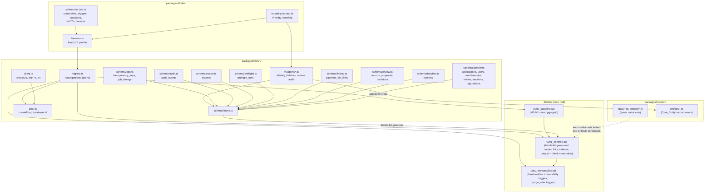
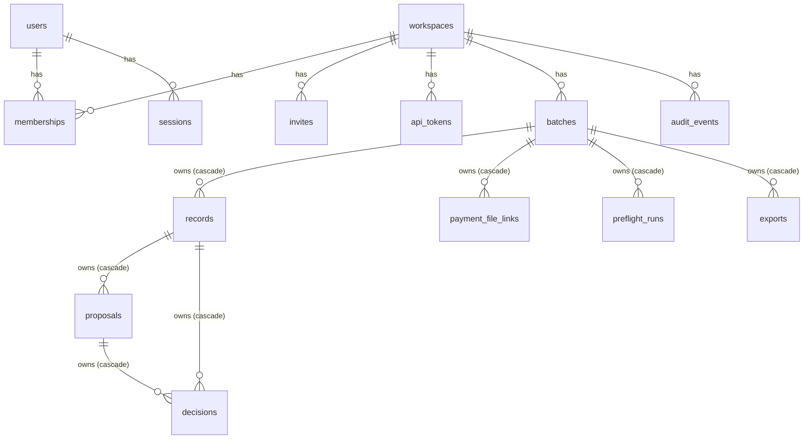

# Design Document

## Overview

This ticket (M1-02) lands the persistence layer of 4x35 once, in one migration chain. It builds:

- The Drizzle Schema_Module for the 16 Persisted_Tables, one file per module.
- The Migration_Chain in the repo-root `drizzle/` folder: `0001` generated by drizzle-kit from the
  Schema_Module, and a hand-written `0002` for the triggers drizzle-kit cannot generate
  (Immutability_Triggers and the `purge_after` default).
- Enum `CHECK` constraints generated from the `@4x35/core` constant arrays, not hand-typed, so a
  new state added to a core enum cannot silently drift from the database.
- `packages/db/src/pool.ts`: the pooled `pg` client (`createPool`, `databaseUrl`), moved out of
  `client.ts` so `migrate.ts` imports neither the schema nor `@4x35/core` (the runtime image copies
  only `packages/db/dist` and `drizzle/`).
- `packages/db/src/client.ts`: `createDb(pool)` over the schema, `withTx` and the `Tx` type.
- `packages/db/src/mappers/`: typed Row_Mappers between Core_Entity values and table rows.
- `packages/db/test/harness.ts`: the per-file fresh-database Test_Harness.
- The root `test:integration` script wiring (the `vitest.workspace.ts` `integration` project
  already exists from M0-06; this ticket adds the `packages/db` test files that run under it).

Everything downstream depends on this: M1-03 (identity repositories), M1-04 (`job_timings`,
`idempotency_keys`, pg-boss alongside these tables), M1-07 (the thin slice stores uploads and
proposals through these mappers), M1-08 (append-only `audit_events` writes), M2-11/M2-14 (later
migrations in the same chain).

Out of scope (ticket, confirmed against requirements.md): the workspace-scoped repository layer
and authorization (M1-03); the pg-boss schema (M1-04, managed by pg-boss itself); audit writes
from features and rate-limit storage (M1-08); `geonames_postal` and `jp_post` (M2-11);
`llm_cache` and `llm_usage` (M2-14); seed data beyond what migrations need (M3-09, M2-24).

## Architecture



### Decision: migrations live in the repo-root `drizzle/`

M0-06 already fixed this location and generated `0000_baseline.sql` there (extensions only).
`drizzle.config.ts` (`packages/db/drizzle.config.ts`) already points `out` at `../../drizzle`
relative to the repo root, and `migrate.ts`'s `MIGRATIONS_FOLDER` already resolves to it. This
ticket adds to that chain rather than relocating it:

- `0001_schema.sql` is generated by `npx drizzle-kit generate --config packages/db/drizzle.config.ts`
  from the Schema_Module. It creates the 16 Persisted_Tables, their foreign keys (`ON DELETE
  CASCADE` on Batch_Owned_Tables), the `records (batch_id, status)` index, the `batches` unique
  Batch_Key constraint, `users.email citext` with its unique constraint, and one `CHECK`
  constraint per Enum_Column.
- `0002_immutability.sql` is hand-written (drizzle-kit does not model triggers or functions) and
  committed alongside the generated migration, with its own journal entry and snapshot so
  `drizzle-kit check` still reports no drift (triggers are not part of what `check` diffs; the
  table/column/constraint shape is, and that shape comes entirely from `0001`).

SCHEMA is a hot file (CLAUDE.md): this ticket owns the migration sequence while it creates the
first chain after `0000_baseline`. Later tickets (M1-04, M1-08, M2-11, M2-14) append `0003`
onward; they do not edit `0001` or `0002`.

### Decision: statement-level triggers on Append_Only_Tables; the cascade is the only delete allowed

`decisions` is both append-only (R7.2: direct `UPDATE`/`DELETE` must raise) and
Batch_Owned (R6.2: deleting its batch must cascade-delete it, through `records`). The triggers in
`drizzle/0002_immutability.sql` (every raise is SQLSTATE `P0001` with a message starting
`immutable:`) are:

- `immutable_statement()`, attached `BEFORE UPDATE` and `BEFORE DELETE` `FOR EACH STATEMENT` on
  `decisions` and `audit_events`. Statement-level triggers fire even when the statement matches no
  row, so `UPDATE decisions SET ... WHERE false` still raises. The one exception is a `DELETE` on
  `decisions` with `pg_trigger_depth() > 1`, which returns and leaves the decision to the row
  trigger below.
- `immutable_decision_delete()`, attached `BEFORE DELETE FOR EACH ROW` on `decisions`. It allows
  the delete only when `pg_trigger_depth() > 1` AND the parent `records` row no longer exists, and
  raises in every other case.

The depth check alone is not enough. A direct `DELETE FROM decisions` issued from inside another
trigger or function also runs at `pg_trigger_depth() > 1`. What distinguishes a real cascade
(from a deleted `records` row, or from a deleted `batches` row through `records`) is that the
parent `records` row is already gone when the cascaded `DELETE` fires. The nested-direct case
still has its parent row, so it raises. Deleting a `proposals` row that has decisions also raises,
because the record still exists.

`audit_events` is not Batch_Owned, so its `DELETE` never needs an exception: `immutable_statement()`
always raises for it.

### Decision: Frozen_Columns triggers compare with `IS DISTINCT FROM`

`batches.original`, `batches.sha256` and `records.original_lines` each get a `BEFORE UPDATE OF
<column> FOR EACH ROW` trigger with `WHEN (OLD.<column> IS DISTINCT FROM NEW.<column>)` that runs
`immutable_columns('<column>')`, which raises. An `UPDATE` that sets the column to its current
value, or changes only another column (`batches.status`, `records.version`), passes (R7.5). The
triggers are `batches_original_frozen`, `batches_sha256_frozen` and
`records_original_lines_frozen`.

### Decision: `purge_after` is set by a `BEFORE INSERT` trigger

`purge_after` is computed in the database, so every insert path gets the same 30-day value and
R5.1 holds regardless of caller. `batches_set_purge_after()` (trigger `batches_purge_after`,
`BEFORE INSERT FOR EACH ROW` on `batches`) always overwrites `purge_after` with
`(created_at AT TIME ZONE 'UTC' + interval '30 days') AT TIME ZONE 'UTC'`, even when the caller
sent a value. `created_at` has a Schema_Module default of `now()`, so a caller that supplies
neither still gets a correct value.

### Decision: enum `CHECK` constraints are generated, not hand-typed

Each Enum_Column's `CHECK` constraint is written in the Schema_Module with `enumCheck(table,
column, columnName, values)` from `schema/columns.ts`. It builds a named `<table>_<column>_check`
constraint with Drizzle's `check()`, from the same constant array the schema modules import from
`@4x35/core` (`BATCH_STATES`, `RECORD_STATES`, `MEMBERSHIP_ROLES`, `BATCH_KINDS`, `TARGET_FORMS`,
`DECISION_ACTIONS`, `ActorKindSchema.options`) or from a constant exported next to the table
(`BATCH_FORMATS`, `EOL_KINDS`, `LINK_STATUSES`, `JOB_OUTCOMES`). Parameters cannot be used inside a
`CHECK` definition, so `enumCheck` asserts each value matches `^[a-z0-9_]+$` before inlining it
and throws otherwise (unit-tested in `test/schema.test.ts`). `columns.ts` also defines the
`bytea` (Uint8Array in, `Buffer` from the driver), `citext` and `timestamptz` (precision 3, `Date`
mode) column types.

Columns checked: `batches` `kind`, `format`, `form`, `status`, `eol`; `records.status`;
`memberships.role` and `invites.role`; `decisions` `action` and `actor_kind`;
`audit_events.actor_kind`; `exports.actor_kind`; `payment_file_links.status`;
`job_timings.outcome`. `exports.kind` and `job_timings.kind` have no CHECK because no source
defines their value sets yet (M2-22 for export kinds, M1-04 for job kinds); those tickets add one in
a later migration.

### Decision: `proposals` stores `pack_id` and `rejected`

`docs/architecture.md` §5 lists `proposals` columns as `id, record_id, pack_version, fields,
findings, confidence, created_at`, but the `StoredProposal` the core package defines
(`packages/core/src/entities/proposal.ts`) also carries `pack: {id, version}` (not just
`pack_version`) and `rejected: {candidate, reason}[]`. Requirement 10.4 (P1) requires the
Row_Mappers to round-trip a `StoredProposal` exactly, so the table gains two columns beyond the
architecture doc's list to make that possible without dropping data on write: `pack_id text not
null` (alongside the existing `pack_version text not null`) and `rejected jsonb not null default
'[]'`. This is the same column set the architecture doc's `pack_version` note already implies a
`pack_id` is needed for ("latest per record" is scoped by `pack_id` too, not just version), made
explicit so the round trip holds.

### Decision: arbitraries exclude U+0000 and lone surrogates

Postgres `text` and `jsonb` columns reject the NUL byte (`text`: `invalid byte sequence`; `jsonb`:
Postgres's own `jsonb` input function rejects `\u0000` even escaped) and cannot store a lone
UTF-16 surrogate half as valid text (`pg` encodes JS strings as UTF-8 before sending; an unpaired
surrogate has no valid UTF-8 encoding). Neither is a 4x35 business rule — they are a storage-layer
limit the Core_Entity zod schemas do not currently exclude. Rather than widen the zod schemas (out
of scope for this ticket; that is a core package change) the P1 arbitraries (`dbSafeString`,
built on top of `packages/core/test/arbitraries.ts`'s `addressLine`-style generators) filter both
out, so the property tests what the database can actually store and does not fail on an input no
real upload pipeline can produce either (CSV/XLSX/XML readers normalise or reject NUL and
unpaired surrogates before a `Record` ever reaches persistence — M2-01/M2-03 concern).

## Components and Interfaces

### Schema modules (`packages/db/src/schema/`)

One file per module, matching `docs/architecture.md` §2's module list and this ticket's scope:

| File | Tables |
|---|---|
| `identity.ts` | `workspaces`, `users`, `memberships`, `invites`, `sessions`, `api_tokens` |
| `batches.ts` | `batches` |
| `review.ts` | `records`, `proposals`, `decisions` |
| `linking.ts` | `payment_file_links` |
| `preflight.ts` | `preflight_runs` |
| `export.ts` | `exports` |
| `audit.ts` | `audit_events` |
| `ops.ts` | `idempotency_keys`, `job_timings` |
| `columns.ts` | `bytea`, `citext` and `timestamptz` column types, and the `enumCheck` helper shared by every table above (not a table module) |
| `index.ts` | re-exports every table (drizzle-kit's schema entry point; already exists as a stub) |

Column shapes follow `docs/architecture.md` §5 and the Core_Entity zod schemas directly:

- `workspaces`: `id uuid pk default gen_random_uuid()`, `name text not null`, `settings jsonb not
  null`, `is_sandbox boolean not null default false`, `created_at timestamptz not null default
  now()`.
- `users`: `id uuid pk`, `email citext not null unique`, `password_hash text not null`,
  `created_at timestamptz not null default now()`.
- `memberships`: `workspace_id uuid not null references workspaces on delete cascade`, `user_id
  uuid not null references users on delete cascade`, `role text not null check (role in
  ('owner','reviewer'))`, primary key `(workspace_id, user_id)`.
- `invites`, `sessions`, `api_tokens`: as named in §5 (one-time tokens, hashed secrets never
  stored in clear — hashing itself is M1-03/M1-08; this ticket only shapes the columns).
- `batches`: `id uuid pk`, `workspace_id uuid not null references workspaces on delete cascade`,
  `kind text not null check (...)`, `format text not null check (...)`, `original bytea not
  null`, `sha256 text not null`, `encoding text not null`, `delimiter text`, `eol text`,
  `column_map jsonb`, `pack_id text not null`, `pack_version text not null`, `form text not null
  check (...)`, `status text not null check (...)`, `failure_reason text`, `locked boolean not
  null default false`, `created_by uuid not null references users`, `created_at timestamptz not
  null default now()`, `purge_after timestamptz not null`; unique `(workspace_id, sha256,
  pack_id, pack_version, form)`.
- `records`: `id uuid pk`, `batch_id uuid not null references batches on delete cascade`,
  `location jsonb not null`, `party_role text not null`, `name text`, `original_lines text[] not
  null`, `country_hint text`, `status text not null check (...)`, `version integer not null
  default 0`; index `(batch_id, status)`.
- `proposals`: `id uuid pk`, `record_id uuid not null references records on delete cascade`,
  `pack_id text not null`, `pack_version text not null`, `fields jsonb not null`, `rejected jsonb
  not null default '[]'`, `findings jsonb not null`, `confidence real`, `created_at timestamptz
  not null default now()`.
- `decisions`: `id uuid pk`, `record_id uuid not null references records on delete cascade`,
  `proposal_id uuid not null references proposals on delete cascade`, `action text not null check
  (...)`, `fields jsonb`, `actor_id uuid not null`, `actor_kind text not null check (actor_kind in
  ('session','token'))`, `at timestamptz not null default now()`.
- `payment_file_links`, `preflight_runs`, `exports`: as named in §5, each `batch_id`/
  `payment_batch_id` referencing `batches on delete cascade` (directly, per R6.1).
- `audit_events`: `id uuid pk`, `workspace_id uuid not null references workspaces on delete
  cascade`, `actor_id uuid not null`, `actor_kind text not null check (...)`, `action text not
  null`, `subject text not null`, `data_hash text not null`, `at timestamptz not null default
  now()`. Not Batch_Owned: it survives a batch (and even a record) delete, matching
  `docs/architecture.md` §5's note that only its hash, not content, is retained long-term.
- `idempotency_keys`, `job_timings`: as named in §5; out of scope beyond having a column shape
  M1-04 can build on (M1-04 owns writing to them).

### `pool.ts` and `client.ts`

`pool.ts` holds `createPool`, `databaseUrl`, `PoolOptions` and the defaults. It imports neither the
schema nor `@4x35/core`, so `migrate.ts` (which imports only `pool.ts`) runs in the runtime image
with `packages/db/dist` and `drizzle/` alone; `test/schema.test.ts` asserts this. `client.ts`
re-exports the pool API and adds:

```ts
export type Database = NodePgDatabase<Schema>;
export type Tx = Parameters<Parameters<Database["transaction"]>[0]>[0];
export function createDb(pool: pg.Pool): Database;
export function withTx<T>(db: Database, fn: (tx: Tx) => Promise<T>): Promise<T>; // db.transaction(fn)
```

`withTx` is a thin typed wrapper over `db.transaction`, which commits on return and rolls back and
rethrows the original error on a throw (R9.2, R9.3). The pool's `statement_timeout` produces
R9.4: a long statement gets Postgres's `57014` error, which `withTx` does not catch.

### `mappers/` (Row_Mappers)

Four files, each exporting `<entity>ToRow` / `<entity>FromRow` pairs typed against the Drizzle
`$inferInsert` / `$inferSelect` types (exported as `<Entity>Row` and `<Entity>Insert`) and the core
types:

| File | Functions | Notes |
|---|---|---|
| `mappers/identity.ts` | `workspace*`, `user*`, `membership*` | `settings` jsonb parsed with `WorkspaceSettingsSchema` on read |
| `mappers/batches.ts` | `batch*`, `record*` | `original: Uint8Array` is stored as `bytea`; `recordFromRow` returns `originalLines` as stored, with no normalisation |
| `mappers/review.ts` | `proposal*`, `decision*`, `storedProposal` | `PersistedProposal` = `{id, stored: StoredProposal, confidence, createdAt}`; `stored.pack` maps to `pack_id`, `pack_version`; `storedProposal(p)` converts a core `Proposal` (a `Proposal` can only be built by `buildProposal`, so a read never returns one) |
| `mappers/audit.ts` | `auditEvent*` | |

`mappers/index.ts` re-exports all four.

Every mapper parses jsonb columns back through the matching zod schema (not just `as`) on read,
so a row that somehow drifted from the schema fails loudly at the mapper boundary rather than
silently handing a malformed object to a caller — consistent with the engineering standard
"validate input at every trust boundary" and with domain-core's design precedent (zod parse
failures are not wrapped).

`packages/db` is the only place `pg`/Drizzle types appear next to Core_Entity types (R10.3);
`packages/core` continues to import neither, unchanged by this ticket.

### `test/harness.ts`

```ts
export interface TestDb {
  readonly name: string;
  readonly pool: pg.Pool;
  readonly db: Database;
  dropAndClose(): Promise<void>;
}
export interface TestDbOptions { migrate?: boolean; statementTimeoutMs?: number }

export async function createTestDatabase(label: string, options?: TestDbOptions): Promise<TestDb>;
export async function databaseExists(name: string): Promise<boolean>;
export function sqlState(err: unknown): string | undefined; // also unwraps DrizzleQueryError.cause
```

- The name is `t_<label>_<PORT_OFFSET>_<random>` (label lower-cased, non-alphanumerics folded to
  `_`, at most 24 characters; 5 random bytes as hex), for example `t_roundtrip_0_a1b2c3d4e5`.
- It runs `CREATE DATABASE` over an admin connection on the base `DATABASE_URL` (never printed),
  then creates a pool (max 4 connections, optional `statementTimeoutMs`) on the new database and
  runs `runMigrations` unless `migrate: false`. If a migration fails, the database is dropped and
  the error propagates.
- `dropAndClose()` ends the pool and runs `DROP DATABASE IF EXISTS "<name>" WITH (FORCE)`, which
  terminates remaining backends, so no separate `pg_terminate_backend` call is made.
- `hasDatabase` is true when `DATABASE_URL` is set; each file uses `describe.skipIf(!hasDatabase)`.

Each `*.int.test.ts` file calls `createTestDatabase` in `beforeAll` and `dropAndClose` in
`afterAll`. There is no `harness.int.test.ts`: the harness test (unique database per file, name
carries `PORT_OFFSET`, database gone after `dropAndClose`) and the `withTx` and statement-timeout
tests are in `test/schema.int.test.ts`.

### Root `test:integration` wiring

`packages/db` has its own `vitest.integration.config.ts` and a `test:integration` script, so
`npm run test:integration -w packages/db` runs its `*.int.test.ts` files alone. The root
`test:integration` runs them for every workspace under the `integration` vitest project. The
default `npm test -w packages/db` excludes `*.int.test.ts`.

## Data Models

The Core_Entity shapes are unchanged from `packages/core/src/entities/*.ts` (built in M1-01),
except for the `proposals` table carrying `pack_id` alongside `pack_version` and `rejected`
jsonb, as decided above — this is a persistence-layer column addition, not a core schema change;
`StoredProposal` in `packages/core` already has both fields today.



## Correctness Properties

*A property is a characteristic or behavior that should hold true across all valid executions of
a system — essentially, a formal statement about what the system should do. Properties serve as
the bridge between human-readable specifications and machine-verifiable correctness guarantees.*

Only Requirement 10.4 (`P-entity-roundtrip`) is scoped as a correctness property for this ticket;
Requirements 1 through 9 and 11 are tested as integration examples (unique violation, check
violation, trigger raise, cascade, idempotent migrate, harness lifecycle), each varying little
with input and each already stated as a concrete scenario in the requirements themselves.

### Property 1: Entity round trip (P1, P-entity-roundtrip)

FOR ALL valid `Core_Entity` values (`Workspace`, `User`, `Membership`, `Batch`, `DomainRecord`,
`StoredProposal`, `Decision`, `AuditEvent`), writing the value through its Row_Mapper's `toRow`
into its Persisted_Tables row and reading it back through `fromRow` SHALL satisfy: the result is
deep-equal to the original value.

**Validates: Requirements 10.2, 10.4**

## Error Handling

- **Unique violations** (`23505`): a repeated `(workspace_id, sha256, pack_id, pack_version,
  form)` Batch_Key, or an `email` that differs only by case, is rejected by Postgres with
  `23505`; the Row_Mappers and `client.ts` do not catch or translate this — callers in M1-03/M1-07
  distinguish it by `error.code` when they build the API's `409`/`422` response (out of scope
  here; this ticket only guarantees the constraint exists and raises).
- **Check violations** (`23514`): an Enum_Column value outside its set raises `23514`, surfaced
  unchanged to the caller, same reasoning as above.
- **Trigger-raised errors**: the `immutable_*` functions raise with
  `RAISE EXCEPTION`, which `pg` surfaces as a rejected promise carrying the message text and SQL
  state `P0001` (the default for a plpgsql `RAISE EXCEPTION` with no explicit `SQLSTATE`); not
  translated by this ticket.
- **Statement timeout** (`57014`): `client.ts`'s pool enforces `statement_timeout`; `withTx` does
  not swallow it (R9.4).
- **`withTx` rollback**: any thrown error inside the callback rolls back the transaction (Drizzle
  behavior) and the same error is rethrown unchanged to the caller (R9.3) — no error wrapping, so
  a caller's own retry/translation logic sees the original error.
- **Mapper read failures**: a jsonb column that fails its zod schema on `fromRow` throws `ZodError`
  unwrapped, consistent with domain-core's precedent (schema violations are a trust-boundary
  check, not swallowed).
- **Harness failures**: if `CREATE DATABASE` or migration fails in `createTestDatabase`, the error
  propagates to the test file's `beforeAll`, failing that file's tests outright (no silent skip)
  rather than leaving a partially migrated database for the test bodies to fail against
  confusingly.

## Testing Strategy

### Unit and integration tests

Everything other than P1 is tested against a real Postgres (`packages/db/test/schema.int.test.ts`,
using the Test_Harness), matching each requirement's own worded scenario:

- R1.5: inserting two `users` rows whose emails differ only by case raises `23505`.
- R2.2: inserting two `batches` rows with the same Batch_Key raises `23505`.
- R3.3: inserting a `records` row without `version` stores `0`.
- R4.3: an insert/update with an Enum_Column value outside its set raises `23514`, one example per
  Enum_Column (`status` on `batches` and `records`, `role` on `memberships`, `kind` on `batches`,
  `form` on `batches`, `action` on `decisions`, `actor_kind` on `decisions` and `audit_events`).
- R5.1: inserting a `batches` row without `purge_after` stores `created_at + 30 days` (UTC).
- R6.2: deleting a `batches` row removes its `records`, `proposals`, `decisions`,
  `payment_file_links`, `preflight_runs` and `exports` rows.
- R7.2: a direct `UPDATE` or `DELETE` on `decisions` or `audit_events` raises, and the row is
  unchanged afterward (re-select and compare).
- R7.3: an `UPDATE` changing `batches.original`, `batches.sha256` or `records.original_lines`
  raises, and the row is unchanged afterward.
- R7.4: deleting a `batches` row (which cascades to `decisions` through `records`) succeeds and
  removes the decisions — the same scenario as R6.2, re-asserted from the immutability trigger's
  point of view (that the cascade is not itself blocked by `immutable_decision_delete`, because the
  depth is greater than 1 and the parent `records` row is already gone).
- R7.2 (nested direct delete): a `DELETE FROM decisions` issued from inside another trigger or
  function, so that `pg_trigger_depth() > 1`, while the parent `records` row still exists, raises
  and the row is unchanged afterward. The test creates a throwaway function and trigger on a
  scratch table inside the test database, fires it, and asserts the error. This proves the depth
  check alone is not what permits a delete.
- R7.5: an `UPDATE` on `batches` or `records` that touches only a non-frozen column (e.g.
  `status`) succeeds.
- R8.1/R8.2: `runMigrations` on an empty database applies every journal entry in order
  (`0000_baseline`, `0001_schema`, `0002_immutability`); a second run applies none and adds no
  `__drizzle_migrations` row (`migrate.int.test.ts`).
- R8.3: `drizzle-kit check --config packages/db/drizzle.config.ts` exits 0 (run in the validation
  gate, not inside vitest, since it is a CLI diff tool rather than a runtime assertion).
- R9.1-9.4: `createPool` and the statement timeout are covered by the pool's own tests; `withTx`
  commit, rollback-and-rethrow and the `57014` surfacing are integration examples in
  `schema.int.test.ts` against the real database.
- R11.1-11.5: the Test_Harness is exercised by every `*.int.test.ts` file; one example in
  `schema.int.test.ts` asserts each file gets its own database, named with `PORT_OFFSET`, and that
  `dropAndClose` leaves no matching database in `pg_database`.

### Property test: P1

**Library**: fast-check (4.10.2), run under vitest in `packages/db/test/roundtrip.int.test.ts`. It
needs the real database, so it runs under the `integration` project, with one Test_Harness database
per file.

- **Test name**: ``P1 (P-entity-roundtrip): write → read is the identity (${NUM_RUNS} runs)``, one
  `fc.assert(fc.asyncProperty(entityGraph, ...))`.
- **Graph per run**: each run generates one connected `EntityGraph` of all eight Core_Entity values
  (workspace, user, membership, batch, record, proposal, decision, audit event) that reference each
  other. The test writes it through the `*ToRow` mappers in one transaction, reads every entity
  back through the `*FromRow` mappers, compares with `toEqual`, and then rolls the transaction back
  (a `Rollback` error). Rolling back leaves the shared database empty, so unique constraints
  (`users.email`, the Batch_Key) cannot collide between runs.
- **`numRuns`**: `NUM_RUNS = Math.max(200, Number(process.env.FC_NUM_RUNS ?? 0) || 0)`, exported
  from `arbitraries.ts`, never below the ticket's 200.

#### Domain arbitraries

No bare `fc.string()`. `packages/db/test/arbitraries.ts` builds on the style of
`packages/core/test/arbitraries.ts`:

- **`text`**: the shared base for free-text fields. Letters from CJK, Devanagari, Arabic, Cyrillic
  and Latin with diacritics; whitespace runs of 1, 2 and 3 or more (space, tab, U+00A0); NFC and
  NFD forms; astral characters as surrogate pairs; lengths at 15/16/17, 34/35/36 and 69/70/71.
  It never produces U+0000 or a lone surrogate (Postgres `text` and `jsonb` cannot store them).
- **Primitives**: `hex64` (64 lower-case hex characters, `Sha256HexSchema`), a millisecond `date`
  (`timestamptz(3)` keeps exactly this), and an `email` that `z.email()` accepts, mixed case so
  `citext` is exercised.
- **Entity arbitraries**: `workspace`, `user` and the nested records for batch, record, proposal,
  decision and audit event, built from the core enum constants (`BATCH_STATES`, `RECORD_STATES`,
  `MEMBERSHIP_ROLES`, `BATCH_KINDS`, `BATCH_FORMATS`, `TARGET_FORMS`, `DECISION_ACTIONS`) and
  parsed through the core zod schemas, and proposals built with `buildProposal` and converted with
  `storedProposal`.
- **`entityGraph`**: `fc.record(...).chain(...)` that threads the generated ids through the eight
  entities, exported with the `EntityGraph` interface. There is no `coreEntityArb` `fc.oneof`: one
  connected graph per run covers all eight mappers and the foreign keys between them in a single
  property.

#### Planted bug

The steering requires that a property fails on a deliberately wrong implementation before the real
code is restored.

- **Planted bug**: `recordFromRow` returned `originalLines: row.originalLines.map((l) =>
  l.normalize("NFC"))`.
- **Result**: P1 failed after 1 run with seed `-1730475784`. The counterexample was a record whose
  `originalLines` held an NFD line `"A\u0308" + "0"` (`"Ä0"`): reading it back as NFC changed the
  stored original.
- It is recorded as `PLANTED_BUG` in `roundtrip.int.test.ts` and in the file header. The real
  `recordFromRow` returns `originalLines` as stored, and P1 passes at 200 runs.

### Verification result

Run on 2026-11-26 (see tasks.md task 12) from the repo root against the local Postgres 17
(`DATABASE_URL` from the environment, never printed).

| Command | Result |
|---|---|
| `npm run db:migrate` (first run) | pass, "nothing to apply" (already migrated) |
| `npm run db:migrate` (second run) | pass, "nothing to apply" (no-op) |
| `npm run test:integration -w packages/db` | pass: 3 files, 20 tests (P1 at 200 runs) |
| `npm test -w packages/db` | pass: 3 files, 11 tests |
| `npx drizzle-kit check --config packages/db/drizzle.config.ts` | pass, "Everything's fine" |
| `npm run db:generate` | pass, "No schema changes, nothing to migrate"; no files created |
| `npm run typecheck -w packages/db` | pass, no errors |
| `npx biome check packages/db drizzle` | pass, 39 files, no fixes applied |

The planted-bug seed and counterexample are under "Planted bug" above. The root
`npm run test:integration` and `npm run lint` were not part of this run.

### Running the suite

`npm run test:integration -w packages/db` runs the `packages/db` `*.int.test.ts` files alone (3
files: `migrate`, `roundtrip`, `schema`). The root `npm run test:integration` runs them for every
workspace. `npm test -w packages/db` runs the unit tests (`schema.test.ts`, `datasets.test.ts`,
`index.test.ts`) and excludes `*.int.test.ts`.
